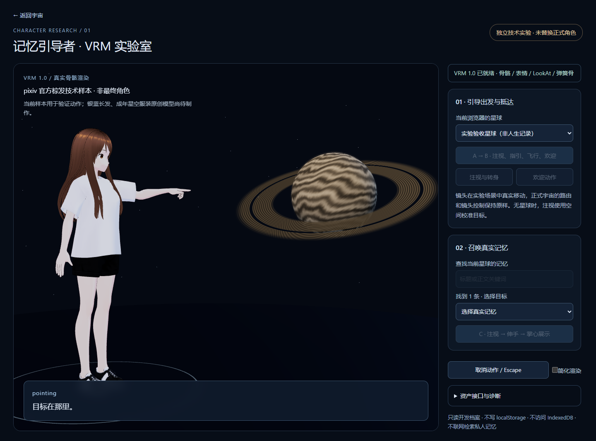
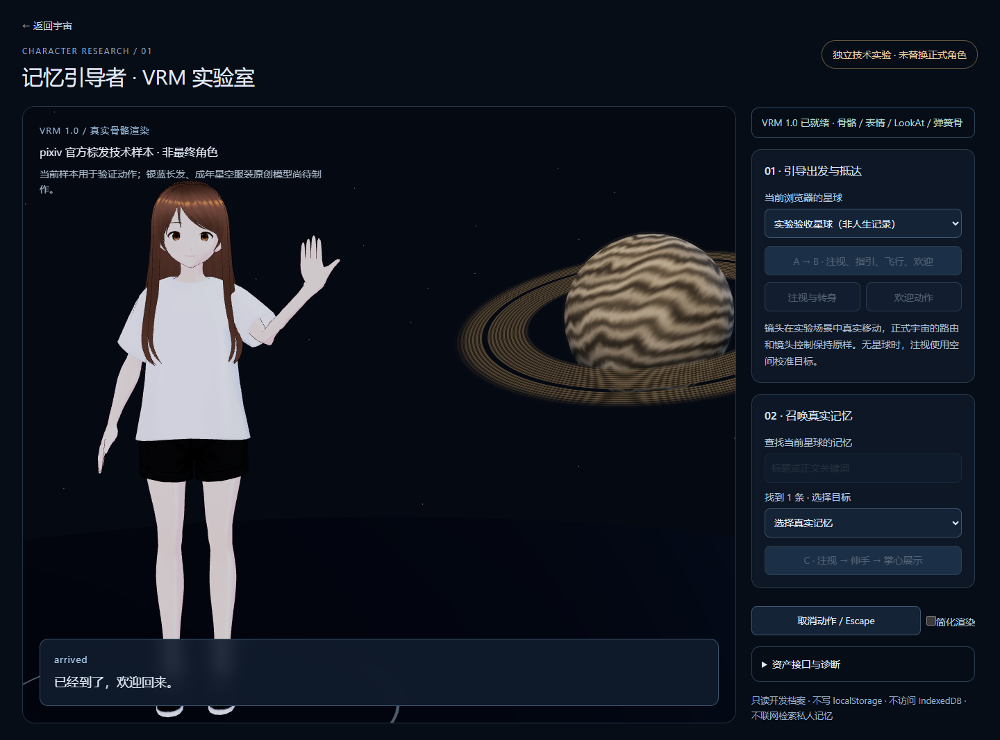
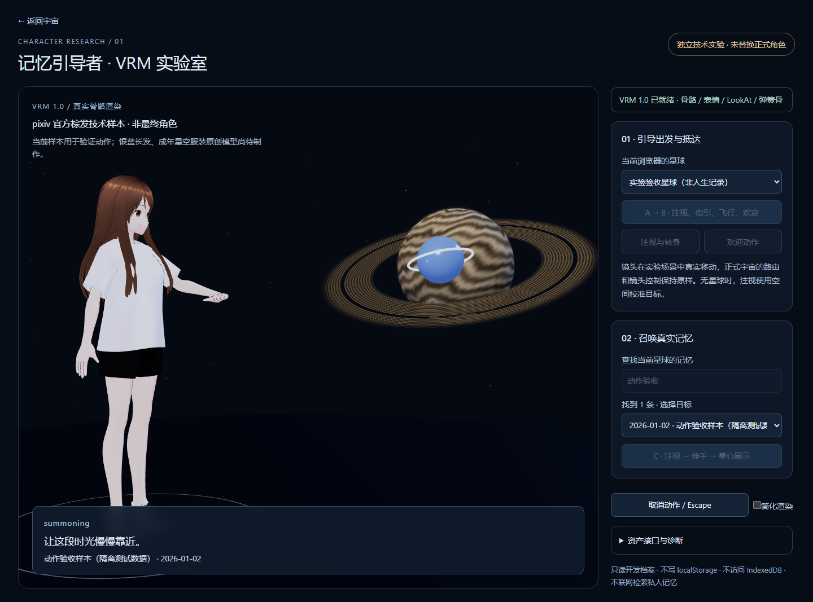
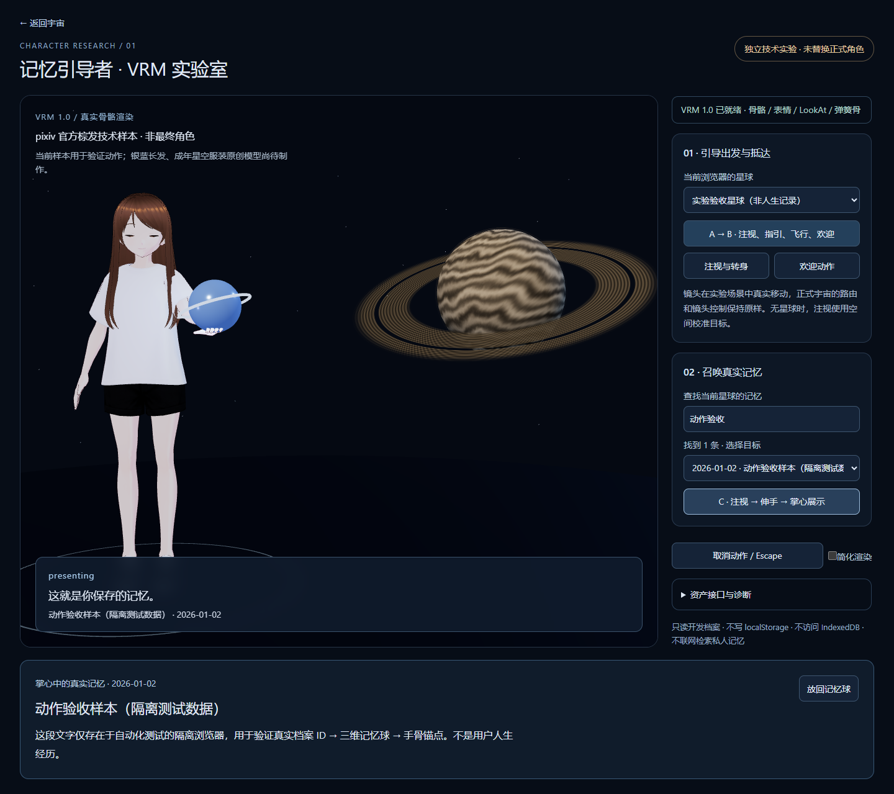

# VRM 实验 · 实际渲染与视觉记录

2026-10-29。以下是运行 Next.js 生产构建、真实 Chrome WebGL 渲染后捕获的截图，**不是设计稿、生成图或 SVG 人物**。截图使用独立测试浏览器里的明确标注合成档案，不包含用户人生数据。当前模型为官方授权技术样本，不是最终角色；视觉是否满足后续制作方向，应由用户观看决定。

## 逐动作证据

| 步骤 | 实际发生的动作 | 原图 |
| --- | --- | --- |
| 1 待机 | 带骨骼的完整 VRM1 模型；胸部骨骼呼吸、blink morph 眨眼 | [待机](evidence/guide-lab-2026-10-29/vrm-01-idle.png) |
| 2 注视 | 模型根朝向转向实际星球，头与 LookAt 对准目标 | [注视/转身](evidence/guide-lab-2026-10-29/vrm-02-attention.png) |
| 3 指向 | 左肩/臂/肘/腕与指骨做指引，完成后才放行镜头 | [指引](evidence/guide-lab-2026-10-29/vrm-03-pointing.png) |
| 4 旅行 | 实验 Canvas 中的相机在世界空间靠近实际星球 | [飞行](evidence/guide-lab-2026-10-29/vrm-04-flight.png) |
| 5 抵达 | 相机实际到达后，人物转回用户，手掌向外欢迎 | [欢迎](evidence/guide-lab-2026-10-29/vrm-05-arrived.png) |
| 6 召唤 | 注视当前真实记忆球、伸手；球沿三维弧线接近掌心 | [召唤中](evidence/guide-lab-2026-10-29/vrm-06-summoning.png) |
| 7 呈现 | 球到达真实手骨标定点后持续跟随，展开该 Memory 的正文 | [掌心呈现](evidence/guide-lab-2026-10-29/vrm-07-presenting.png) |
| 8 手机视口 | 390×844，触屏校准动作、模型失败/恢复、reduced-motion 与手臂回落 | [手机完整页面](evidence/guide-lab-2026-10-29/vrm-08-mobile.png) |

指引（A）：

抵达欢迎（B）：

召唤与掌心展示（C）：

## 基本测量

完整原始数据见 [vrm-measurements.json](evidence/guide-lab-2026-10-29/vrm-measurements.json)。Windows / Headless Chrome 156 / ANGLE Intel Graphics D3D11、16 逻辑核；桌面视口 1440×1050，DPR 上限 1.5，包含实际截图、保留绘图缓冲和测试调度开销。不是独立 GPU 基准，也不是实机手机性能结果。

| 场景采样 | FPS | p95 帧时 | draw calls | 三角形 |
| --- | --- | --- | --- | --- |
| 初始加载后 | 36 | 54.1 ms | 26 | 84,852 |
| 呼吸/眨眼待机 | 55 | 17.7 ms | 26 | 84,852 |
| 指引 | 52 | 17.9 ms | 26 | 84,852 |
| 抵达 | 52 | 17.6 ms | 26 | 84,852 |
| 掌心展示 | 54 | 17.7 ms | 28 | 87,220 |

模型下载/解析 334.2 ms；29 张 GPU 贴图。托球时球心到掌心锚点误差 0.00 cm（该帧），眨眼峰值 0.999。指引时根朝向从 0.080 转至 1.038 rad；相机位置从 [0.250, 1.200, 3.900] 移至 [-0.096, 1.200, 3.257]，不是只更新台词。

初始帧存在着色器编译/贴图提交等冷启动波动；多轮采样的暖机结果也有约 43–55 FPS 的变化，不能据单次接近 60 FPS 认定全设备性能通过。

FPS 为最近最多 240 帧的帧间隔均值，p95 是同一窗口的第 95 百分位；加载阶段/截图会影响采样。手骨到球心本来有球半径和掌心偏移，误差表示球心到**标定掌心目标**的距离；0 不等于无穿模或物理接触质量通过。

## 实际观察与未通过项

- **已看见**：模型有真正三维体积、头发和肢体；侧身观察目标、指向、面向用户欢迎、球从远处飞到手上。手势来自骨骼，不是整张人物图移动。
- 第一轮指引腕部方向不正确、到达镜头截断人物；已校正指向手腕和镜头构图。第一版 reduced-motion 冻结 mixer 导致手臂停留，已改为冻结 clip 时间、保留淡入淡出时间，并用实际手骨高度回归。姿态切换同时保留上一帧真实 IK 姿势做短插值，避免只混合底层 clip 造成手臂突然跳回。
- **仍偏生硬**：转身绕根部原地旋转，缺少脚步/重心；抬手和指向是程序化短动作，尚无动画师精修的预备/惯性/收势。不能宣称动作已达到自然成片质量。
- **碰撞局限**：当前选取角度未见记忆球明显钻入躯干；衣袖靠近肘部有折线，发丝可能与上臂/衣服交叠。没有全身、布料或任意姿势无穿模保证，换模必须重标掌心和检查碰撞体。
- **美术未完成**：棕发、日常衣服样本不符合最终银蓝长发、成年深蓝星空服装 brief；面部/服装材质偏基础，尚未达到要求的精致最终角色质量。手机上为保留人物与目标同时可见，人物较小，精细观感还需最终资产和手机构图专项验收。
- **尚未集成**：A/B 是独立场景中的真实镜头导航，没有替换正式宇宙 B2 路由和 SVG。没有 AI、语音、复杂剧情或最终动作资产包。现有正式 CRUD 与持久化继续由原页面提供。

## 如何复现证据

`npm.cmd run build` 后执行 `npx.cmd playwright test tests/browser/guide-lab.spec.ts`，截图和 JSON 生成在 `test-results/vrm-*`。测试使用单独 3100 服务与隔离浏览器，不访问日常浏览器数据；不会往用户档案添加截图中的验收样本。要亲自体验真实记录，请按 [实验指南](GUIDE-LAB.md)在日常同源地址打开 `/guide-lab`。
