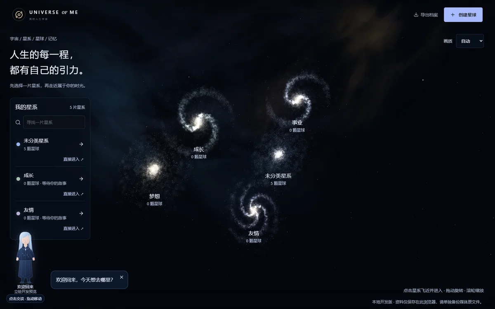
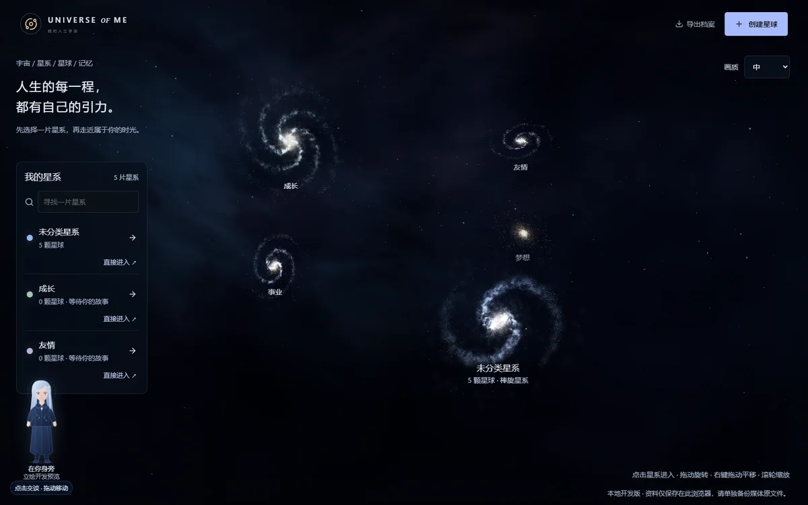
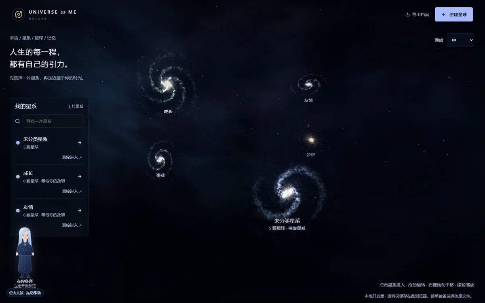
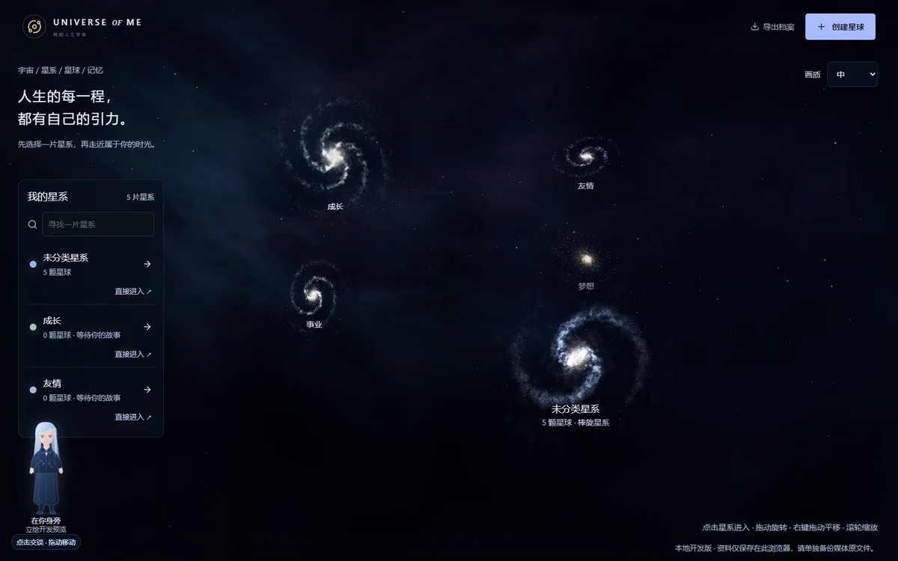
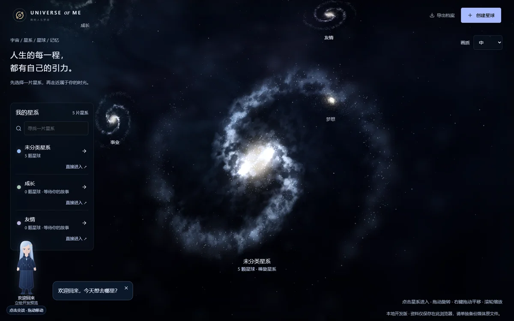
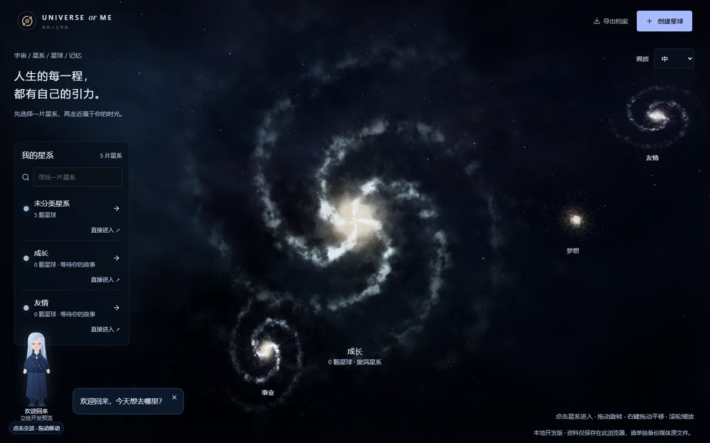
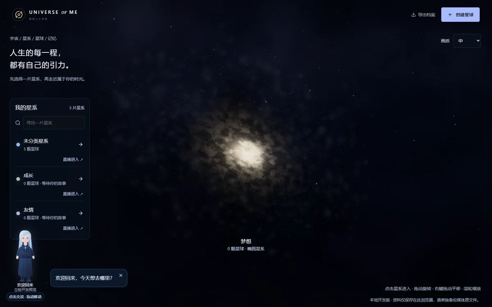
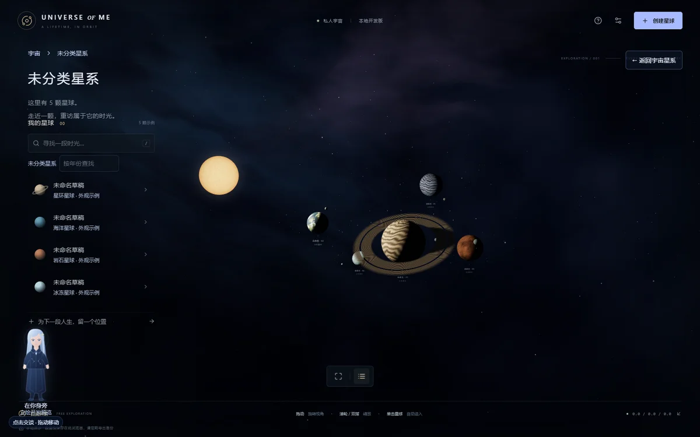
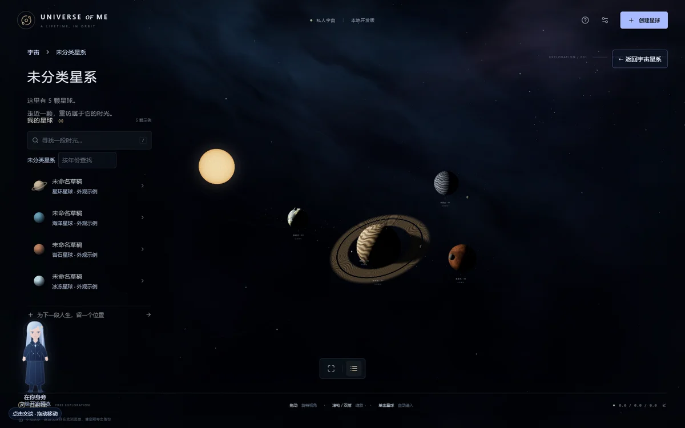
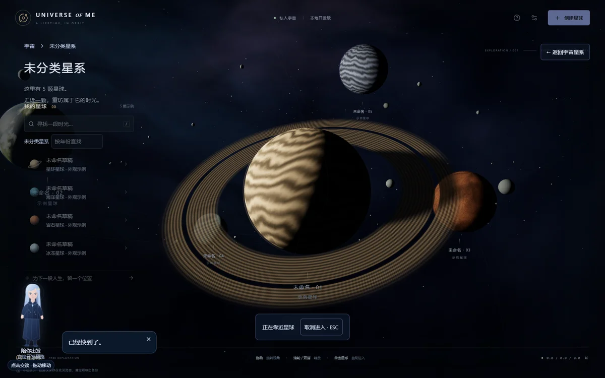

# V4.0-A2 实际视觉与性能审阅

2026-10-30。实现及本地运行证据已完成，**视觉验收等待用户判断，未宣称达到电影级最终效果**。所有图片来自实际 Chrome WebGL；只把仓库内预览等比缩为 1200px WebP，没有重绘。原始 1600×1000 PNG 和连续视频在本地证据包。示例星球明确标识，未读取用户日常浏览器资料，也没有编造人生经历。

## 先看实际画面

左列基准 A1 提交 `1e3fd48`；两图均为 1600×1000、DPR 1、FOV 43，相机 position `[0,13.1093513358,87.3956755719]`，target `[0,0,0]`。画质为中档。星系的派生展示坐标和形态调整，因此对象构图改变；没有改变比较相机。记录见 [comparison-view.json](reviews/v4-a2/comparison-view.json)。

| A1 同视角 | A2 同视角 |
| --- | --- |
|  |  |

| 相机实际左移 | 相机实际右移 |
| --- | --- |
|  |  |

真实世界坐标近景参照 `[10,-3,48]` 横移 **128.67px**，远星 `[210,-60,-900]` 横移 **5.39px**，约 **23.9 倍**；两者在左右取景中均可见。相机与 target 同向平移，不是旋转、屏幕贴图或 CSS 位移。实际顶点与诊断共用常量。

| 棒旋近景 | 四臂旋涡近景 | 椭圆星系近景 |
| --- | --- | --- |
|  |  |  |

## 连续录屏与原始证据

本机可直接打开 `artifacts-local/v4-a2/review.html`，其中包含前后对照、所有原图和 `universe-galaxy-planet.webm`（29.48 秒，1600×1000，25fps VP9）。12 张图及视频播放均已核验，详见 [播放检查](reviews/v4-a2/review-check.json)。视频是一次真实浏览器会话：点击 3D 星系 → 推进 → 内部 → 点击 3D 星球 → 飞近 → 自动进入记忆空间 → 返回原视角，没有拼接，也没有用手动路由跳转代替星球点击。

大文件和原始 PNG 留在忽略目录，不加入普通 Git；本页小型 WebP 审阅图、[原始性能 JSON](reviews/v4-a2/performance.json)与[原图/视频 SHA-256 清单](reviews/v4-a2/evidence-manifest.json)随分支提交。独立打包 ZIP 供本机保存，不包含私人用户资料。复现：先 build 并在 3400 启动生产服务，再执行 `node --experimental-strip-types scripts/capture-spatial-review.mjs`；可设 `SPATIAL_REVIEW_URL` 指向其他测试 origin。脚本只使用独立 Chrome 配置；保存的 A1 缩略基准可供新环境复现同视角对照。

## 性能条件与结果

Windows 11 Pro / Intel Core 5 220H / Intel Graphics，Chrome **156.0.8078.49**，ANGLE D3D11；渲染器原文 `ANGLE (Intel, Intel(R) Graphics (0x0000A7AA) Direct3D11 vs_5_0 ps_5_0, D3D11)`。视口 1600×1000，设备 DPR 1.5，各档限制实际 DPR。生产构建，隔离无头 Chrome，一次只运行一个采样页；录屏另行进行。初始 5 星系/5 外观示例行星，没有大量用户星球压力。每档固定同一相机，预热后采六个约一秒静止窗口、五个重复平移/阻尼窗口；表中 p95 为各窗口 p95 的最大值，不是全部帧合并的 p95。FPS 受约 60Hz 的浏览器调度上限限制，不能据此判断各档 GPU 开销相同。

| 场景 / 档位 | 实际 DPR | 静止 FPS 范围 | 平均帧间隔 ms | 静止 p95 上界 ms | 拖动窗口 FPS | 拖动 p95 上界 ms | draw calls / points（末窗口） |
| --- | --- | --- | --- | --- | --- | --- | --- |
| 宇宙 / low | 1 | 60–60 | 16.67 | 17.4 | 60–60 | 18 | 30 / 9,632 |
| 宇宙 / medium | 1.35 | 60–60 | 16.66 | 17.7 | 59–60 | 18.6 | 31 / 25,346 |
| 宇宙 / high | 1.5 | 60–60 | 16.67 | 17.6 | 60–60 | 18 | 31 / 33,728 |
| 内部 / low | 1 | 60–60 | 16.67 | 17.3 | 60–60 | 18 | 24 / 1,601 |
| 内部 / medium | 1.35 | 60–60 | 16.67 | 17.9 | 60–60 | 17.7 | 25 / 3,801 |
| 内部 / high | 1.5 | 60–60 | 16.67 | 17.7 | 59–60 | 18.9 | 25 / 5,001 |

宇宙末窗口约 30–31 个几何体、0 纹理、6 个程序；内部约 24–25 个几何体、5 纹理、10 个程序。内部低/中/高约 30,778 / 93,600 / 104,400 三角形。末窗口 JS heap 约 14.1–37.3 MiB，受 GC 影响，不能当作画质内存排序。没有 GPU timer/VRAM 字节测量，也未采浏览器总驻留内存。宇宙高档某窗口最大单帧间隔 35.2ms，说明平均 60 FPS 不代表完全没有长帧。

390×844、设备 DPR 2 的桌面触控模拟自动使用低档、渲染 DPR 1，采样约 60 FPS；无横向溢出，真实 tap 进入星系成功。**不是手机真机、续航或热稳定验收。**

## 实现与尚未达到的部分

- 五层实时表示、68%/27%/5% 的原预算分配、超过 200 单位的星系深度跨度、多形态与慢速自转；没有增加原有恒星总预算。星云仍有少量平面，极端侧视会显得单薄；远处球壳是程序背景，不是完整体积星云。
- 可见恒星与点光源同坐标；原行星坐标、大小、外观配置不变。恒星是球面着色，尚无物理日冕/耀斑；阴影主要来自球面明暗和程序星环投影，未启用全场景真实阴影图。卫星/碎片为有限装饰，不是新业务数据。
- 星核改为有界 alpha 恒星与中心尘埃衰减，但近景仍存在局部高亮裁切；星盘着色仍是平面 + 三维核球/厚度星点混合，不是全体积星系模拟。行星表面程序纹理仍是原版，星环仍偏薄，没有伪称完成影视资产升级。
- 世界坐标视差、连续位置/target/FOV、弧线推进、ESC 连续回程、单任务锁及原视角返回均有实际验证。宇宙和内部属于不同路由/局部空间，使用短渐隐及二次推进衔接；**尚非统一坐标中的完全无缝宇宙**。
- 预热采样不覆盖冷编译成本；巡检的冷进入曾出现约 0.3–0.7 秒长帧。未做大量星系/行星、低端安卓或长期内存增长专项。旧 A1 的近距离宇宙书签保留原坐标，因派生星系位置改变，可能需要缩远或从列表定位；没有静默重置偏好。
- 捕获期间没有 JS pageerror 或着色器编译错误；有一次资源 HTTP 404，未在独立网络复查中重现，来源未确认。正式人物、VRM 实验、档案 schema、媒体接口与浏览器主数据未变；隔离捕获中档案原文前后一致。

## 手动检查

1. 访问生产预览，右键拖动平移、左键旋转、滚轮缩放；观察近景移动快、远星移动慢。质量切换不应改变记录。
2. 点击一个星系，途中 ESC 取消，再选另一个；应回到出发视角并恢复控制。直接列表入口仍可用。
3. 进入有星球的星系，观察恒星方向、昼夜面、轨道倾角和卫星；设置里可关闭三维轨道。
4. 单击星球自动飞近并进入；新增/编辑记忆、照片/视频保存并刷新查看；返回所属星系应恢复原视角。
5. 查看本页及连续录屏，判断是否满足希望的浩瀚、尺度与临场感；上述功能和性能检查不替代这一步。
