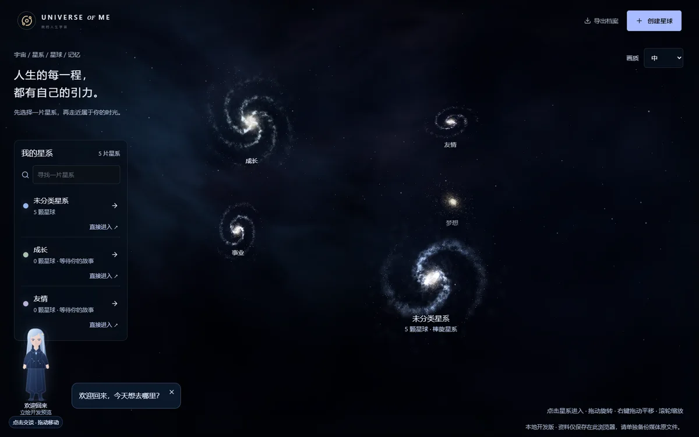
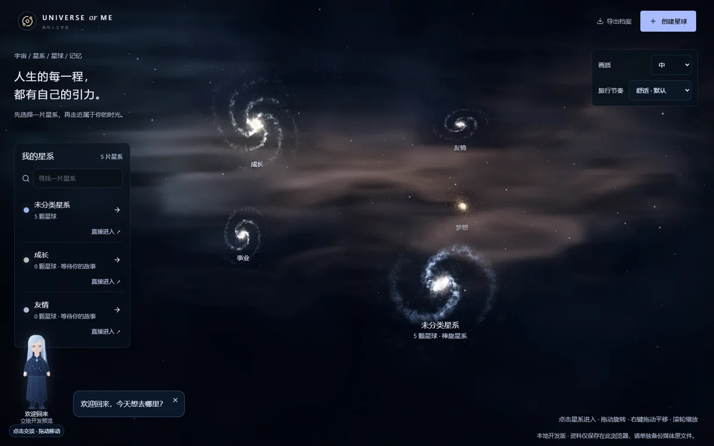
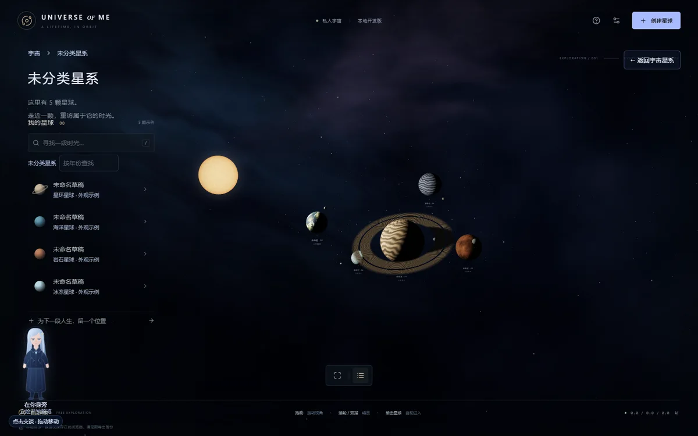
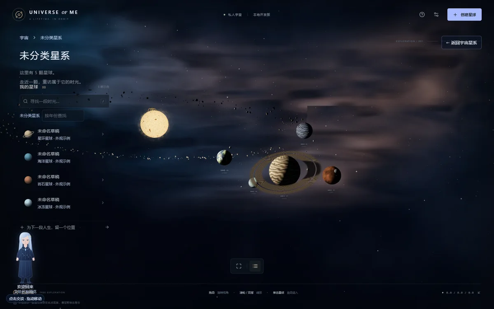
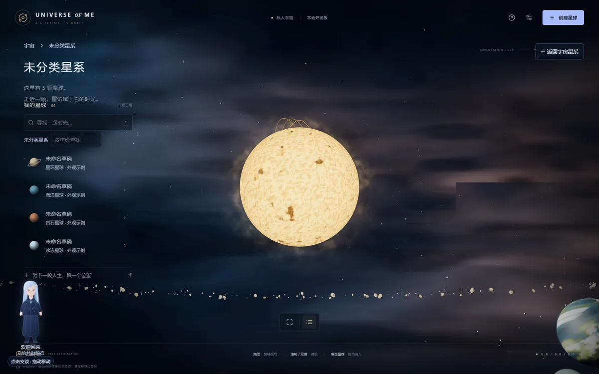

# V4.0-A3 实际视觉与舒适旅行审阅

本轮从 A2 最新 `1c7be0e` 增量开发，不重建页面或数据。用户视觉验收仍待进行，不能把以下检查当作“电影级效果”或“无眩晕”的认可。

## 打开实际成果

运行站点：`http://127.0.0.1:3300`。原始 PNG / WebM / 审阅页在 `artifacts-local/v4-a3/review.html`，证据 ZIP 为 `artifacts-local/UNIVERSE-OF-ME-V4-A3-visual-review.zip`。目录不提交普通 Git；随代码保存小型 WebP、原始性能 JSON、复现机位、SHA-256 清单于 [reviews/v4-a3](reviews/v4-a3)。ZIP 解压后打开 review.html 可离线看图与录屏。

宇宙和内部对照均使用 A2 / A3 相同 position、target、43° FOV，1600×1000 CSS、DPR 1、中档；相机见 [comparison-view.json](reviews/v4-a3/comparison-view.json)。星系有缓慢自转，人物欢迎提示随时间有差异。空星系补了真实环境边界，全景随之改变，因此空星系对比明确不是同机位。

| A2 | A3 |
| --- | --- |
|  |  |
|  |  |

## 实际改变

- 远景带状星海与中近景参照保留，在其间加入有界三维密度积分星云、冷暖亮区及暗尘埃，去除旧雾平面；没有简单上调星点数量。
- 恒星使用无接缝三维颗粒/暗斑/能量网络、临边昏暗、两层有限光冕及局部磁弧。低档一层光冕、一条弧。可见恒星与照明同坐标，行星受光、大气、星环阴影一致。
- 真实星球坐标不变；倾斜 Instancing 碎片带避开原行星。空星系有三颗标为环境的天体，不增加 Planet / Memory，不提供伪造的记忆入口。
- 默认舒适，固定 FOV、取消额外弧线抬升，以启动/稳定前进/减速/停稳控制推进。内部二次缩近从 1.7 倍收敛到舒适的 1.12 倍。ESC、连点锁、真实视角返回、触屏及 reduced-motion 保留。

## 旅行实录

`journey-comfort.webm` 和 `journey-fast.webm` 是实际浏览器通过两次 3D 点击完成宇宙→星系→星球的连续录像，没有以 URL 跳转代替飞行。

| 模式 | 星系推进参数 | 星球推进参数 | 每次停稳 | 点击至星系 URL 实测 | 点击至记忆 URL 实测 |
| --- | --- | --- | --- | --- | --- |
| 舒适（默认） | 6.8 秒 | 5.2 秒 | 1 秒 | 8.26 秒 | 6.76 秒 |
| 标准 | 4.8 秒 | 3.6 秒 | .65 秒 | 本轮未单独录屏计时 | 本轮未单独录屏计时 |
| 快速 | 2.8 秒 | 2.2 秒 | .25 秒 | 3.50 秒 | 3.25 秒 |

实际墙钟包含停稳、渐隐和路由调度，低帧率下会因每帧 dt 限幅而更长。内部到达另有轻量二次推进；系统减少动态时改为 .12 秒且无停稳。

`comfort-vs-fast.webm` 将两段实录从首次点击对齐，左舒适、右快速，在浏览器中同步播放两段原片、以 25fps 再录制，保持原速，快速结束后保持末帧；原录像为 25fps。是同步播放对比录屏，不冒充单次宇宙连续探索录屏。完整原录像仍独立保留。

## 实测性能

Windows 11 / Core 5 220H / Intel Graphics（D3D11，驱动 32.0.101.7076）/ Chrome 156.0.8078.49 / 1600×1000 / 设备 DPR 1.5。渲染 DPR 上限低 1、中 1.35、高 1.5。各档同相机，预热后 5 个约一秒静止窗口、4 个右键平移窗口；没有录屏竞争 GPU。原始逐窗口数据、相机、draw calls、点数、三角形、资源数、JS heap 均在 [performance.json](reviews/v4-a3/performance.json)。

| 场景 | 质量 | 静止 FPS | 平移 FPS | 静止均帧时 ms | 静止 p95 上界 ms |
| --- | --- | --- | --- | --- | --- |
| 宇宙 | low | 60–60 | 60–60 | 16.66–16.67 | 17.4 |
| 宇宙 | medium | 60–60 | 58–60 | 16.61–16.72 | 21 |
| 宇宙 | high | 60–60 | 60–60 | 16.65–16.67 | 17.5 |
| 内部 | low | 60–60 | 60–60 | 16.66–16.68 | 17.4 |
| 内部 | medium | 60–60 | 60–60 | 16.64–16.67 | 18.2 |
| 内部 | high | 48–60 | 59–60 | 16.53–20.76 | 38.7 |

星云的像素预算独立于设备 DPR：560×350 / 640×400 / 800×500，4/7/11 步，RGBA8 无深度附件；这只是附件规格，不是实际 GPU 内存测量。全分辨率初版使高档掉到 18–27 FPS，未将那版作为性能合格结果。主渲染约 26–30 calls，另有一次体积 pass；纹理宇宙 1、内部 6（含离屏纹理），JS heap 约 18–26 MiB。未测 GPU timer、GPU 实际字节、长期泄漏、重负载或手机真机。移动仅 Chrome 390×844 / DPR2 / 触屏模拟，低档，未横向溢出。

## 数据与功能验证

最终 lint、strict typecheck、42/42 单元测试、生产 build 通过；生产 Chrome 完整回归 26/26 通过，星球进入定向 4/4 通过。短渐隐状态测试改为逐帧观察以避免错过取消窗口，未修改产品渐隐时长或弱化数据断言。详见 PROGRESS。浏览器使用隔离 context，不连接用户日常 Chrome，不清空、迁移或写入用户浏览器。截图采集前后档案原文相同；已有回归覆盖新增/编辑/删除、文字、照片、视频、刷新、旧关系迁移和 IndexedDB 媒体。

最终采集无 pageerror / 着色器错误；唯一控制台 404 已定位为既有 `/favicon.ico`，不影响场景或存储。采集脚本第一版的 MutationObserver 启动过早错误已修正并重录；这些失败素材不作为最终证据。

## 已知限制与下一步

- 近景星云仍有局部不自然的明暗边界，已加入边界衰减，尚未消除所有积分伪影；低步数可能显出带状结构。
- 恒星是视觉近似，磁弧仍偏规则；非真实太阳辐射/磁流体仿真。行星纹理与星环未重做，近距离仍有程序化外观。
- 高档内部有 48 FPS 窗口、p95 38.7ms，未达到稳定 60 FPS；建议集显先用中档或低档。
- 路由间仍渐隐至局部坐标场景，非统一天文坐标下无缝推进。舒适模式改善节奏，是否仍有眩晕需用户实测。
- 不继续人物、AI 或数据库工作。下一步先根据同机位截图、实际录屏和用户体验调整构图、恒星细节与旅行参数。
