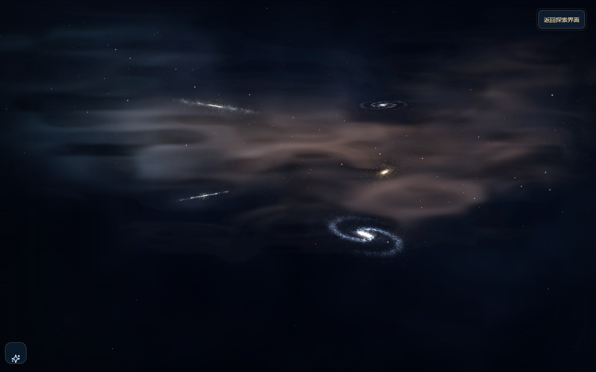
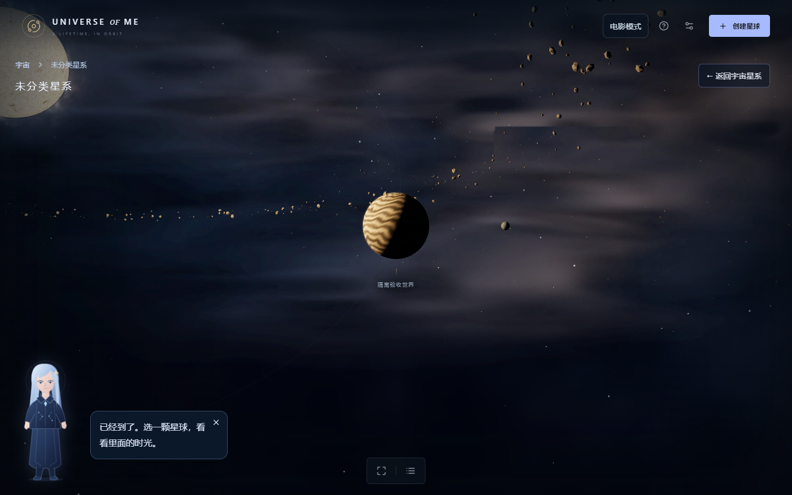
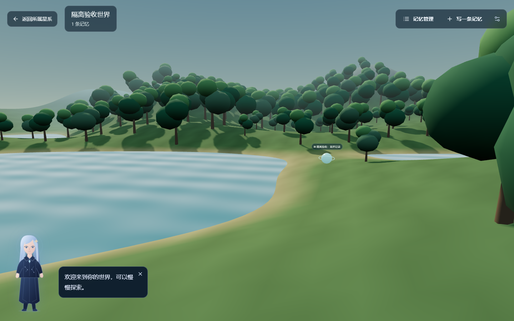
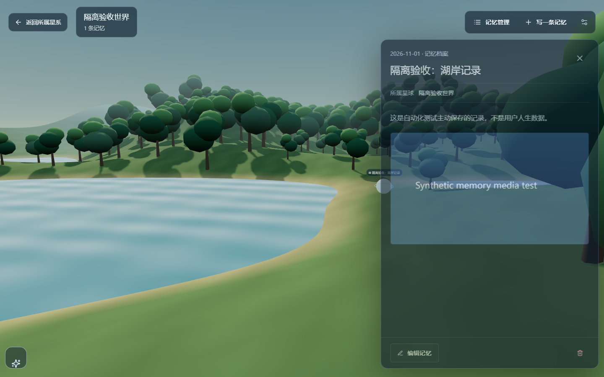
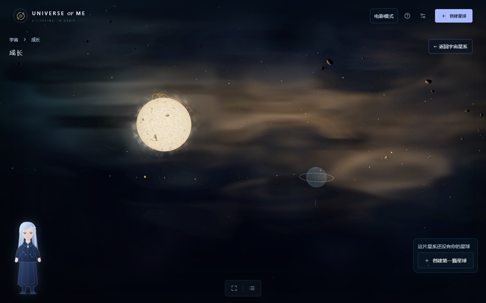
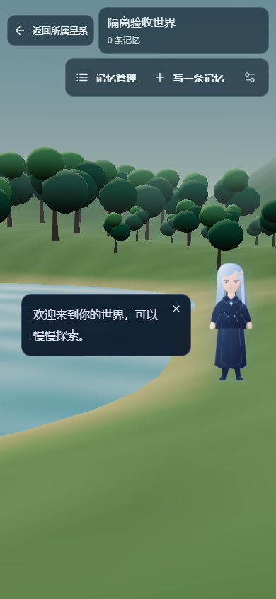

# V4.1-R1 实际运行审阅

日期：2026-11-01。基线为 `0d0a2e0`（A4 分支包含的上一轮 P0–P4 运行时），本轮分支 `codex/v4-1-r1-world-first`。所有截图和录屏来自 Windows 本机 Chrome 的生产构建，不是生成概念图。浏览器使用独立上下文；「隔离验收世界」和记忆均为测试主动创建的记录，不是用户经历，也不会写入用户日常浏览器。

## 实际变化

- 点击星球后到达即进入，没有原先 CameraRig 1 秒停留与路由 380ms 等待。距离已近时按实际距离缩短航程，已在进入位置时不设最短动画时长。
- 默认 `/planet/[id]` 为全视口三维湖岸：地形、天空、树林、水体、昼夜光照预设、有限相机探索和 WASD 移动。无记忆也有环境。
- 真实 Memory ID 对应可射线点击的三维球；记录增删同步场景，正文、照片和视频仍用原档案组件。记忆管理、筛选、年份和星球编辑隐藏在抽屉，旧记忆球展示是辅助模式。
- 宇宙导航、设置默认收起，标签按距离/悬停出现。电影模式隐藏普通 HUD，有固定恢复按钮与人物入口。
- 空星系无居中卡片，仅角落创建提示、全息待创建星位和环境。未增加任何用户星球或虚构记忆。
- 修复人物在阅读状态下隐藏后无法恢复的分支冲突、透明顶部栏拦截电影恢复、管理/详情叠层，以及抽屉年份输入被挤到零宽的问题。

## 实际截图

## 录屏位置与复现

本机可直接打开 `artifacts-local/r1/delivery/index.html`，页面包含截图和两段视频：

- `complete-journey.webm`：宇宙→真实镜头进入星系→射线点击星球→默认空世界→使用界面保存文字/照片→刷新→点击世界对象→阅读编辑→返回星系。没有跳过飞行或通过 URL 替代主旅程。
- `guide-mobile-resize.webm`：空星系、人物隐藏/恢复、拖动吸附、刷新位置保留、390×844 视口和世界管理操作。

录像保留本地，避免将多轮大型视频放进普通 Git 历史；Git 只保存当前截图、测试、测量脚本和本文。可运行 `npx.cmd playwright test tests/browser/world-first.spec.ts` 重新产生相同流程的视频。源码不引用本机截图或概念图作为场景背景。

## 手动操作

1. 使用原来的访问地址与浏览器，避免因为不同端口看起来像数据丢失。打开导航，进入已有星系。
2. 单击自己创建的星球；镜头飞近后直接进入世界，飞行未完成前 ESC 可取消。
3. 拖动/双指平移/滚轮探索；聚焦画面后 WASD 移动。右上角「写一条记忆」保存文字或媒体。
4. 关闭详情，点击新出现的三维记忆对象；刷新后再次打开，确认正文与原媒体仍可读。
5. 「记忆管理」中搜索、年份/类型过滤、排序、编辑资料或删除。打开管理会关闭阅读抽屉，选中或保存记录会关闭管理，避免相互遮挡。
6. 返回所属星系，确认恢复原探索视角。宇宙电影模式使用右上角「返回探索界面」恢复。人物隐藏后用星光按钮恢复。

## 实现限制与视觉判断

- 当前世界是**风格化湖岸原型**，低面数树冠、规则水纹、地貌细节仍较简单；没有参考图中的精细建筑、瀑布、环境生命、文明演化或写实植被。这些不标记为已完成。
- 所有星球共用这套环境原型，尚未按星球类型生成专属生态；对象位置由 Memory ID 派生，但对象密集时仍可能局部接近，批次最多 24 个，管理列表可读全部记录。
- 手动昼/夜光照，不是自动日夜时间模拟。水没有真实反射探针、物理折射或水下运动。相机为有限范围探索，不是完整第一人称碰撞系统。
- 远近相机飞行在同一外部场景内连续；外部星球和内部世界仍是路由切换，非无缝行星尺度流式加载。首访还会有实际模块与 WebGL 初始化开销，未用固定定时器掩盖。
- 人物依然使用已有 SVG 开发资产，本轮没有声称升级角色美术。电影模式保留紧凑入口。
- 仅浏览器本地存储，无账号/鉴权/加密/云同步；数据 schema、迁移与 CRUD 未改。JSON 导出仍不含媒体 Blob，需要单独保存原媒体。
- 浏览器窄屏和触摸模拟不等于真实手机 GPU/系统验收；视觉与舒适度最终仍需用户实际体验。

## 自动化与性能实测

最终 lint、typecheck、44/44 领域测试、production build 通过。全量浏览器 31/31 通过（4.4 分钟）；最后电影人物 hydration 修正后，受影响 R1 4/4 再次通过（54.9 秒）。无跳过旧用例。

性能环境：Windows 11 Pro 10.0.26200、Intel Core 5 220H、Intel Graphics（驱动 32.0.101.7076），Chrome 156 headless 使用 ANGLE D3D11 硬件渲染。视口 1440×900、实际 DPR 1；预热 2 秒，每档 10 次约 1 秒窗口，在没有并发测试的同一隔离浏览器采样。场景为稳定视角，水面/星系仍实时渲染，不是截图估算。

| 场景/档位 | FPS 范围 | 平均帧间隔 ms | 最差窗口 P95 ms | 主场景 draws | 三角面 | 几何/纹理/程序 | JS 堆上界 MiB |
|---|---:|---:|---:|---:|---:|---|---:|
| 宇宙 / low | 60–60 | 16.67 | 17.60 | 30 | 7028 | 31/1/7 | 15.7 |
| 宇宙 / medium | 60–60 | 16.66 | 17.50 | 30 | 7028 | 31/1/7 | 17.1 |
| 宇宙 / high | 60–60 | 16.67 | 17.70 | 30 | 7028 | 31/1/7 | 28.4 |
| 世界 / low | 60–60 | 16.67 | 17.50 | 5 | 38666 | 5/0/5 | 18.9 |
| 世界 / high | 60–60 | 16.67 | 18.10 | 5 | 122258 | 5/1/9 | 29.5 |

测量无 pageerror。帧间隔来自 requestAnimationFrame，不是 GPU timer query；JS 堆不是显存。宇宙还包含每帧一个离屏体积 pass，表格 draws 是主场景计数；世界无该 pass。均接近显示刷新率上限，不能据此推断更多性能余量。尚未做真实手机、DPR 2/3、大量媒体或长时间旅行压力测试。

原始数据：[measurements.json](reviews/v4-r1/measurements.json)。复现：先在 3321 启动 production 服务，再运行 `node scripts/review-world-performance.mjs`（也可通过 REVIEW_URL 指向测试服务）。脚本用独立浏览器上下文，不读写日常 Chrome 档案。
