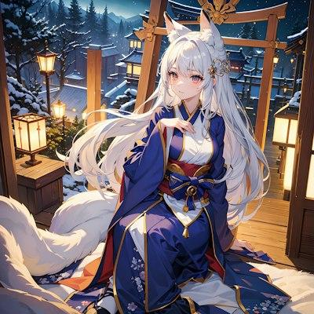

# G1 · 方向 A：银蓝星灵 · 主视觉参考

登记日期：2026-10-29。参考编号：`G1-REF-A-001`。角色制作编号仍为 `UOM-G01`；「银蓝星灵」是用户选择的视觉方向，不自动成为角色姓名。

**用户已确认此图为主要风格参考，未确认最终人物效果图。此图不是项目最终原画，不作为直接建模蓝图。当前不开始正式建模。**

## 来源与文件

- 来源：用户在当前会话提供的图片及随后指定的本地 JPG 文件；已原样复制到本目录，未裁切、调色、放大或重新生成。
- 原文件为桌面上以 `wNRrso8X2pCVMPbmJw2UUDnYf7DHsMPP` 开头的 JPG；仓库归档采用可读名称 `G1-A-silver-blue-spirit-reference.jpg`。
- 文件信息与 SHA-256 见 [来源记录](G1-A-source.json)。仓库路径供后续会话直接查看原图，不依赖聊天记录或用户桌面路径。
- 作者、制作方式与商业授权未提供。登记为用户提供的风格参考，不标为项目原创资产，不作为角色纹理、正式立绘或最终模型直接使用。

## 可见特征与原创转化

以下区分图片中可见的内容和项目拟采用的设计，不把单张图中看不到的背面、结构或身体比例当作已确定事实。

| 重点 | 原图可见特征 | G1 采用方式 |
| --- | --- | --- |
| 五官气质 | 细致眉眼、柔和脸部转折，轻微微笑与安静注视；眼睛有偏暖的粉紫感 | 借鉴精致、温柔、专注的情绪可读性，重新设计具体眼形、脸型与眉嘴关系；延续成年设定，不凭参考图推定年龄 |
| 银蓝长发 | 主体接近银白，阴影偏冷蓝灰；细分发束、长弧线与明显体积，肩前/肩后有层次 | 保留冷色发光感和丰富分束，沿用 G1 偏右细编发、三层后发等独立识别点；不能只做白色单块长发 |
| 狐耳 | 浅色毛绒耳朵融入头部轮廓，耳尖与内耳有色差 | 采用有厚度的自然耳根和柔和毛簇，独立设计大小、外展角与连接方式；正侧背必须一致 |
| 服装层次 | 深蓝外衣、浅色内层、腰部多层束带、少量金色饰件与局部暖色；宽袖和长衣摆形成大形 | 延续深靛主衣、温灰内领、旧金细节；原创交领、袖片和星轨扣结构，兼顾指引/托球时手部完整露出 |
| 幻想氛围 | 冷色雪夜与暖灯形成对比，发丝和衣料有柔和边缘光；人物安静但不呆板 | 转译为深空冷光与克制暖色点光，不沿用神社场景；脸、手、发束层次必须在中性光下也成立 |

## 与既有设定的关系

这张图取代此前泛化的作品描述，成为 G1 **主要风格参考**；此前「灵动、柔和、狐妖幻想」保留为情绪词。既有 [美术设定](../ART-DIRECTION.md) 中的独立脸型、成年比例、偏心双弧星轨扣与可读的手部动作空间继续作为原创设计基础。

参考图中的大尾巴、神社/鸟居、雪景、具体头饰、腰饰、暖色眼睛和红色内衬**不因出现在参考图中就自动加入项目**。当前维持不设大尾巴的方案；眼睛暂沿用灰蓝与浅金内圈提案，最后以用户确认的效果图为准。若效果图需要改变这些设计，须在同次确认中更新设定表，不能让三视图或模型阶段自行改动。

原图为带姿态、衣物遮挡和环境光的单张效果参考，不能从中准确测定身高、头身、背部发型、衣片裁剪、骨骼或耳根结构。不得把推测当成原图事实，也不据此直接进行图生 3D。

## 外观一致性流程

1. **先制作原创人物效果图。** 用本图提炼风格，结合 G1 设计形成 `UOM-G01` 自己的脸、发、耳、衣服与标志；给出完整人物和清晰脸部细节。当前仅选定方向，最终效果图尚未制作、未确认。
2. **用户确认后建立外观基准。** 记录批准的图片文件/版本/日期，同时记录脸型、眼形与瞳色、刘海/发束分区、编发位置、耳朵大小/朝向、领袖结构、腰扣位置、衣摆分层、色票及头身比例。环境光颜色和材质本色分开说明。
3. **三视图从同一基准展开。** 共同对齐头顶、肩、腰、膝与足底；背面只补结构，不另创发型和服装。效果图未显示的部位列为待设计项，补全后一起审核，不用独立生成的三个人物拼图。
4. **表情图只改变表演。** 六表情沿用同一脸型、眼距、瞳色、刘海与耳根，不因开心/惊喜改变人物年龄感和身份。附中性对照与形变强度。
5. **建模有两个前置条件。** 用户明确确认最终效果图，且三视图/结构细节具备一致的建模依据；之后才推进正式建模。模型中性光转台和脸部特写需与批准基准对照，偏差回到源稿修正。

使用单一角色编号与版本记录贯穿交付。未经确认的候选图标记 `candidate`，只有用户明确确认的效果图标记 `approved`；本参考保持 `style-reference`，不会随方向确认自动变为最终资产。

## 当前状态

- 已完成：原图归档、主风格方向确认、视觉特征解读与一致性约束登记。
- 待完成：原创人物最终效果图，以及用户对该效果图的明确确认。
- 尚未推进：正式建模、将参考图替换为产品人物、制作最终角色纹理。
