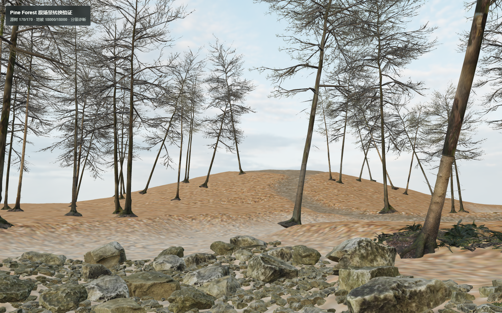

# Pine Forest 第一批：恢复与浏览器渲染稳定性

日期：2026-11-02。分支：`codex/pine-forest-vertical-slice`；恢复检查点：`6a342c2`。只处理恢复、相机、Shader 与 WebGL 白屏，不验收动态分区、LOD、性能或美术。

## 恢复范围

开始时有 4 个已跟踪文件修改及多个未跟踪实验目录，实际恢复检查点共收录 53 个文件。包括五个实验路由、完整源模型转换与布局提取脚本、分区／预算草稿、相机 reorder 和两份不完整的 Shader 诊断。全部保留，没有 reset、覆盖原稿、删除源资产或合并 main。先前已有的分区代码只是被保存，本批没有推进其实现或验收。

原 `.blend` SHA-256 实测仍为 `FDCE77741081F462F11E5CEFE8BF79A0BC796727DBB6E51D12FC6CF20E9C9CFB`。原始模型、4K 材质、源矩阵、提取清单及派生资源保留在原仓库外目录与 Git 忽略的本地静态目录。没有触碰记忆系统、localStorage、IndexedDB 或持久化结构。

## 相机

保留 `/forest-origin-lab` 的 `lookAt` 后 `rotation.reorder("YXZ")` 修复；旧 `/forest-source-lab` 共用相机也改用 reorder 并去掉冗余顺序赋值。不能在 lookAt 后直接改 order 来重新解释 Euler 数值。

Chrome 中同机位实际位置为 `[23.1554737091, 0.9223032594, 47.5597991943]`，方向为 `[-0.9821439487, 0.1260486988, -0.1396602648]`，与源相机→目标的归一化方向吻合。五次加载均检查此方向、W 行走位置变化及鼠标拖动后的方向变化。初始机位截图如下。

这仍是上一轮的局部源模型转换效果；稀疏树冠、地表和光照差距没有在本批修饰或宣称达标。

## Shader／白屏根因与修复

在未修复版本，用 `/forest-origin-lab?trees=170&props=18000&radius=65` 重现 `fern_02_source_pbr` 两次链接错误和随后的 `webglcontextlost`，画面接近全白。这个可见集实际提交 81,413,829 个三角形、188 次 draw call。白屏时约 60 FPS 的计数无效。

Three.js r180 的 `WebGLProgram.js` 在 **LINK_STATUS 为 false** 时打印 `VALIDATE_STATUS false`，因此日志标题不能直接证明某个 GLSL 语法有错。原失败驱动日志为空。新诊断保存完整顶点／片元源代码、编译状态和日志、链接状态和日志、绘制时实际绑定状态下的显式 validate 结果，以及上下文事件；保留 Three.js 错误检查。避免在 compile/link 后立刻同步读取状态，防止诊断本身改变编译调度而掩盖故障。

单棵真实冷杉的 `fir_twig_single_tree` 与单株真实蕨类的 `fern_02_source_pbr` 均成功编译、链接并验证。蕨类保留原 4K 贴图的最小对照也通过。最小诊断使用源实例矩阵，仅强制提交该对象以确保目标 Shader 真正被绘制，不生成替代网格。

导致本机白屏的可复现触发条件是资源压力：原地被 GLB 有 38 张接近 4096² 的 WebP 图像。WebP 只减传输体积，上传后按 RGBA8 加完整 mip 链估算约 **3,232.67 MiB**，并非 109 MB 下载大小；解码、其他树木和地形还有额外开销。这是静态估算，不是 GPU 显存实测，也不能进一步断言 Windows 驱动内部的 OOM/TDR 类型。

修复让原场景实验使用上一轮已生成但该路由未使用的 `source-props-web-1k.glb`：38 张图估算约 **202.04 MiB**。审计两包的 114 个源对象名、90 个 primitive、顶点／索引数量、全部材质名、alphaMode 和 doubleSided 一致。没有删树、删地被、减少测试实例、改模型拓扑或生成新美术；只限制浏览器所用地被贴图分辨率。4K 原包保留，可用显式 `sourceTextures=1` 重现旧路径。1K 近景细节损失需要后续视觉审核。

同样的 170 棵树、18,000 个地被、原坐标、81,413,829 个初始三角形在修复后五次均正常显示。旧 4K 路径在本轮两次出现同一故障，最后追加的 A/B 对照中也有一次成功（完整 Shader 状态通过）；因此这是间歇故障，不能写成 4K 每次必定失败。证据支持贴图资源压力触发上下文／链接故障，而不是 `fir_twig`／`fern_02` 本身有确定的 GLSL 语法错误。

额外加入上下文丢失和完整 Shader 失败日志、可见错误提示及“重新加载场景”。上下文丢失时撤销就绪标记；Canvas 创建失败和加载异常也有提示。用 `WEBGL_lose_context` 主动注入故障后验证提示、撤销就绪、点击重载及重新获得有效上下文。

## 五次独立加载

Windows、Chrome 156、ANGLE Intel Graphics / D3D11、1440×900、DPR 1，production build。每次新建独立 Chrome 进程和浏览器上下文，使用相同 URL、相同机位和相同模型实例。每次检查截图像素分布、真实 draw、编译／链接／validate 状态、页面／控制台／资源错误、上下文事件及行走／转向。

| 独立加载 | 真实画面 | 失败 Shader / 上下文事件 / 浏览器错误 | 原机位与交互 | 检查总耗时 |
| --- | --- | --- | --- | --- |
| 1 | 正常 | 0 / 0 / 0 | 通过 | 13.542 秒 |
| 2 | 正常 | 0 / 0 / 0 | 通过 | 13.224 秒 |
| 3 | 正常 | 0 / 0 / 0 | 通过 | 13.145 秒 |
| 4 | 正常 | 0 / 0 / 0 | 通过 | 12.798 秒 |
| 5 | 正常 | 0 / 0 / 0 | 通过 | 12.328 秒 |

每次观察到的 9 个 WebGL 程序全部通过编译、链接和显式验证。上述时间含截图、等待和交互，不是纯加载时间，也不是性能基准。高负载约 6 FPS，仍不适合实时漫游；本批只证明这个固定场景的短时渲染稳定性。未测真实手机、其他 GPU、长时热稳定、全场景分区移动或全量 LOD。

## 实际检查与证据

- strict TypeScript、修改文件的定向 ESLint、`git diff --check`、production build、源实例清单和贴图／源对象变换一致性校验通过。没有重装现有正常依赖，也没有运行无关的领域测试或全量浏览器回归。
- 三项最小模型检查通过（冷杉、1K 蕨类、原 4K 蕨类）；上述五项独立高负载加载通过。
- 注入上下文丢失后，错误提示、就绪撤销、按钮重载恢复通过。测试初版误把 Canvas 中不可见的 WebGL fallback 当作仍显示的错误，已改为检查实际可见提示后通过。
- `summary.json` 是小型审阅结果；最终构建的五次完整 Shader 源代码和日志在 `artifacts-local/pine-batch1-five-final/results.json`；最小模型在 `artifacts-local/pine-batch1-final/results.json` 条目 1–3。原失败在 `artifacts-local/pine-batch1-baseline/results.json`，完整失败 Shader 源码／空编译链接日志在 `artifacts-local/pine-batch1-regression-4k/results.json`；追加 A/B 对照（两者均通过）在 `artifacts-local/pine-batch1-ab/results.json`。贴图审计在 `artifacts-local/pine-batch1/texture-residency.json`，故障恢复在 `artifacts-local/pine-batch1-recovery/`。
- [修复前白屏](before-white.png)与上方修复后截图均为真实 Chrome 截图，不是 Blender 渲染。

复现正常验证：启动 production 服务后，设置 `FOREST_LAB_URL` 指向该服务，运行 `node scripts/forest-lab/verify-render-stability.mjs`；默认是五次 16/1000 的既有诊断预算。本次高负载可用 `PINE_ROUTES` JSON 数组指定五次 `/forest-origin-lab?trees=170&props=18000&radius=65`。`PINE_EVIDENCE` 指定结果目录。贴图审计运行 `node scripts/forest-lab/audit-texture-residency.mjs`，恢复检查运行 `node scripts/forest-lab/verify-context-recovery.mjs`。

第一批到此停止。下一批单独验证动态分区、LOD 与性能；不把本轮短时固定机位结果扩写成完整森林验收。
