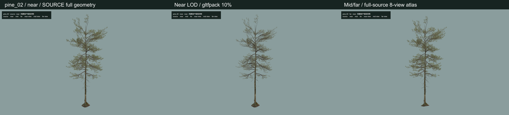
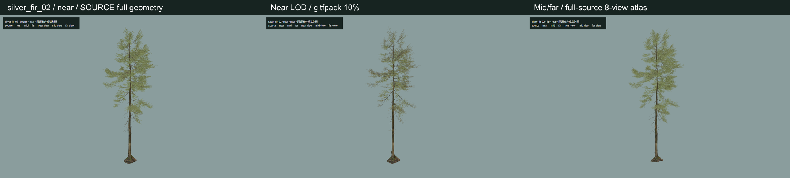
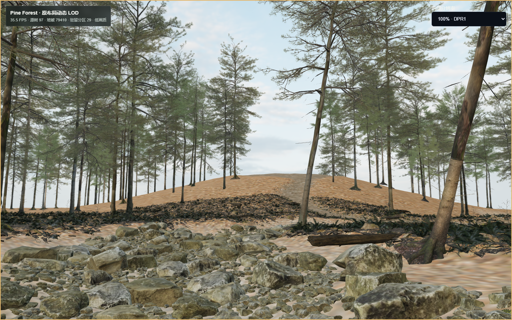
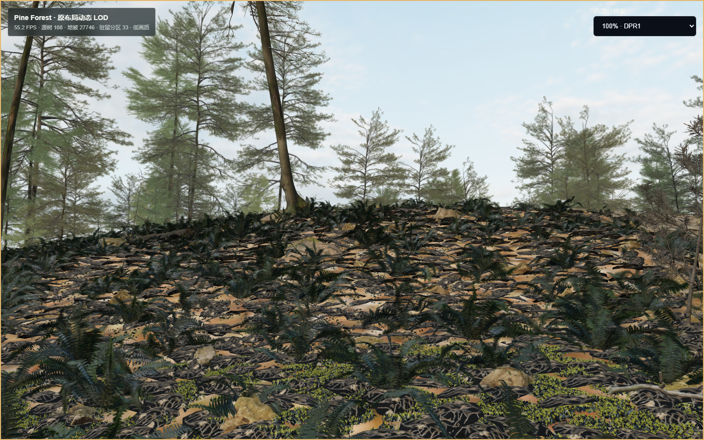
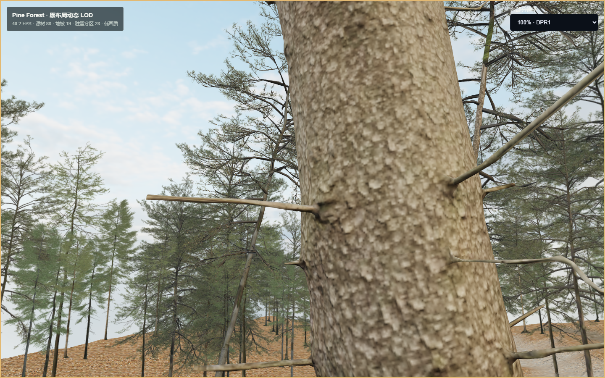
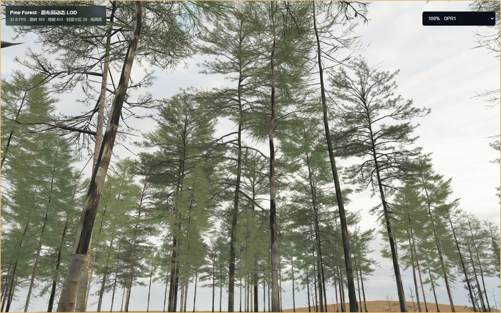

# Pine Forest 第二批：LOD、动态分区与性能

日期：2026-11-03。分支：`codex/pine-forest-vertical-slice`；起点 `08bec0f`；本批检查点标签：`pine-forest-batch2-20261103`。本批到此停止，不启动第三批、不接入正式星球。

**结论：渲染负担大幅降低，平均帧率已超过约 30 FPS，但“自然外观 + 连续移动稳定约 30 FPS”的整体验收仍未通过。** 密集地被区域仍有 50–83 ms 的 P95 帧间隔；多角度树木表示存在模糊、角度切换和深度局限，原地形偏浅、Cycles 透射/体积及河流转换差距仍在。不能把这批结果当成原始 Blender 场景等价移植或最终画质认可。

## 真实环境与方法

Windows 11，系统 Chrome 156，ANGLE Intel(R) Graphics `0xA7AA` / D3D11；1440×900，设备 DPR1。production build，独立 Chrome 进程/上下文。没有使用 SwiftShader 或禁用 Shader 检查。

帧率表使用浏览器 `requestAnimationFrame` 的**实际整段平均 FPS**，P95 由该段全部帧间隔计算；没有用中位 FPS 代替平均 FPS。页面 HUD 另报 R3F 最近 120 帧中位数，不能和整段均值混用。静止基线先暖机再测 12 秒；运动脚本通过真实键盘与鼠标行走、转向，受树干碰撞和帧时间影响，每次走到的位置略有差异，因而 100%/80% 是路径级观察，不是逐帧相同相机的 GPU A/B。

完整原始结果见 [summary.json](summary.json)。生产录屏与详细逐秒数据保留在被 Git 忽略的 `artifacts-local/pine-batch2/`；这些是浏览器证据，不是 Blender 动画。没有进行真实手机、其他 GPU、长时热稳定或整个森林全量驻留验收。

## P1：优化依据

相同原机位的第一批固定集为 170 棵树、18,000 个地被，实际提交 **81,413,829 三角形 / 188 draw calls / 187 textures / 163 geometries**。干净生产复测为 **5.71 平均 FPS / P95 200.6 ms**。首次显示约 6.7 秒；此时间与动态路径的“先显示粗档、后台补全”含义不同。

| 分离实验 | 实际提交三角形 | 短时中位 FPS |
| --- | ---: | ---: |
| 树木 + 地形 | 18,501,950 | 30.40 |
| 地被 + 地形 | 63,042,963 | 7.05 |
| 原完整固定集 | 81,413,829 | 5.65 |

两项都含同一地形，不能直接相加。静态 accessor 审计在不计视锥剔除时得到：树木约 9.92M 独立几何三角形，双面 BLEND 两次绘制约 19.06M；地被约 66.41M / 67.27M。树木约 **92%** 几何属于 twig 针叶/枝片。实际提交的地被约占总量 77%。

最大重复开销是 `moss_patch_01/02/03_lod0`（各约 1,400–1,500 实例，合计约 22.85M 几何三角形）以及 `rock_moss_set_02_rock07…13_lod0`（约 500–560 实例/型号，约 4.1–5.5M 三角形/型号）。实例化已经存在，**实例化不减少每个实例的顶点着色和栅格工作**。

原组级剔除的实测审计：18,388 次 primitive-instance 提交中，16,435 次的逐实例包围球完全在视锥外，约 **69.38M / 81.28M** 提交三角形可避免。这里一个整树可含多个 primitive，不能把这些数字写成独立树数。

Three.js r180 的双面透明材质默认背面/正面两次绘制。相同固定集改 `forceSinglePass` 后约 71.94M / 146 calls，短时中位约 6.07 FPS；改低阈值 alpha test 约 5.72 FPS。收益远小于地被 LOD/逐实例剔除，因此没有把激进 alpha 裁切作为解决针叶质量的方法。默认保留 BLEND 与 single pass；`?alpha=mask` 仅诊断。

WebP 的下载体积不等于 GPU 纹理占用。本批实查发现 gltfpack 对已有 WebP 直通，`-tl 1024` 不保证重采样；已用 Sharp 显式缩放并验证新近景树贴图最大 1024。地被始终复用第一批验证的 **38 张 1K 图像**。静态 RGBA8+mip 估算：地被约 202 MiB，近景树共享的 21 张图像共约 112 MiB，11 棵树八方向 atlas 约 132 MiB，另有地形/HDR/驱动开销。**约 446 MiB 只是上述贴图的静态估算，不是 GPU 显存实测。** 浏览器没有提供可靠的进程独占显存数值，本批不虚报 GPU memory。

## P2：同源 LOD 与视觉对照

- 原 `.blend`、完整固化 GLB、全部原纹理及旧 LOD 不变。Blender SHA-256 再验仍为 `fdce77741081f462f11e5cefe8bf79a0bc796727dbb6e51d12fc6cf20e9c9cfb`。
- 近景：复用 gltfpack 1.3 从完整原树生成的 10% 误差约束网格。11 种树约 89K–797K 三角形/树，保留真实树干、树枝、UV 与针叶材质；1K 贴图及共享材质降低驻留。没有绿色多面体树冠。
- 中/远景：从**完整未减面原树**在真实 Three.js PBR 渲染中烘焙 8 个水平方向，384×768/方向，1536² RGBA atlas/树种。运行时是可移动相机的 Three.js 实例化植被 impostor，每树 2 个三角形，依据原树局部方向选择 atlas。它不是背景图、背景视频或新的树种；但也不是具备完整体积/视差的几何树。中远共享该同源表示，以屏幕占比和距离决定何时切回近景真实几何。
- 树木切换依据距离、投影像素直径和约 10% 滞回；近景通常在 18m 内且大于约 700 像素直径。投影使用当前内部渲染分辨率，降低分辨率也会改变 LOD 分布。中远显示范围约 95m，没有树数上限或随机删树。
- 地被：gltfpack 三档 25%/4%/0.8%，误差上限 0.3%/1%/2%；共 382,339 / 81,221 / 45,644 源库三角形，误差约束可能高于目标比例。共享第一批原 1K 图像，保留 114 个源名和源坐标。极薄平面被简化为零时，显式使用其原资产另一档非空 sibling，不静默丢实例。近景 <6m 且 >120px，中景 <17m 且 >24px；极小 (<1.5px) 和 40m 外地被不提交，地形和原树仍显示。

下图依次为完整原树几何、近景 LOD、中远同源 atlas；三列都是 Chrome 实际画面。完整原树仍是既有 glTF PBR 转换，不等同原 Cycles 节点着色。





另见 [松树中景](pine_02-mid-comparison.png)、[松树远景](pine_02-far-comparison.png)、[冷杉中景](silver_fir_02-mid-comparison.png)、[冷杉远景](silver_fir_02-far-comparison.png)。近景可以看到减面损失；atlas 不适合贴身查看，不能以右列近景示例作为推荐用法。8 方向切换可见跳变，固定烘焙光照不能响应未来昼夜变化，垂直俯仰与透明深度排序仍有限制。本批没有宣称这些限制已解决。

## P3：原布局与动态驻留

全量源清单 **585 棵树 / 879,825 个地被**保留，没有随机抽稀、重排或新增树。60 个原地被分区完整保留；原先构建的运行清单额外含 `-4_-4` 的仅树边缘块，因此运行清单是 61，而不是把源分区数量改成 61。逐记录对照所有 880,410 个源矩阵/源名通过，float32 最大绝对误差约 `5e-8`。原地形、岩石、路径与地貌不重建。

运行时使用紧凑 float32+gzip 分区；完整传输清单约 38.05 MB。按相机到分区边界距离排序，最多两路请求；约 80m 周边分区预取，8 秒离开宽限后释放。先显示共享粗档树和地被，近档异步补充，局部资源加载不再让整个场景 Suspense 白屏。当前实验实际驻留约 29–36 个必要邻块，并非一次提交全部森林。

4m 小单元包围盒先筛，再逐实例包围球做视锥剔除；同源几何/材质按 LOD 实例化。相机静止时跳过重建，移动/转向时降低筛选频率；meshopt 使用两个解码 worker。近档资源离开 12 秒后调用 geometry/材质/纹理释放；共享 atlas 按引用计数回收，实例 buffer 单独 dispose。粗档库有界保留，供回头/切换时快速显示。

连续运动的独立验证观察到 **23 个旧分区、10 个近/中档资源释放**，`geometries/textures`、驻留清单和释放计数均在原始 JSON 中；有录屏的运行观察到 19/7。这里证明显式资源释放行为，不能替代 GPU 驱动进程显存回落的测量。较早测试中的错误索引/404、零几何源 patch 和开发版无植被首帧问题均保留在 `artifacts-local`，不计为通过样本。

## P4：性能结果

| 生产 Chrome 场景/阶段 | 平均 FPS | P95 ms | 提交三角形 | draw calls |
| --- | ---: | ---: | ---: | ---: |
| 优化前固定集，静止 | 5.71 | 200.6 | 81.41M | 188 |
| 优化后原机位，DPR1 静止 | 36.24 | 33.6 | 7.34M | 141 |
| DPR1 密集区域前行 | 38.51 | 50.1 | 3.12–7.46M | 130–180 |
| DPR1 斜向行走 | 58.39 | 17.1 | 1.25–4.52M | 25–128 |
| DPR1 转向后行走 | 36.05 | 33.9 | 4.31–8.33M | 41–59 |
| DPR1 中景停留 | 31.42 | 50.1 | 5.61M | 44 |
| DPR1 连续转向 | 32.69 | 34.1 | 6.95M | 55 |
| DPR1 远景停留 | 34.95 | 33.7 | 6.95M | 55 |
| 80% 内部分辨率，密集区域前行 | 35.24 | 83.1 | 3.42–7.00M | 133–177 |

相同原机位几何提交减少约 **91%**，draw call 下降约 25%，已上传纹理计数约 **187→78**。新动态路径显示更多原始地被/树木，和旧 170/18,000 的固定子集不是完全相同内容；不能将 6 倍帧率写成严格同内容 A/B。

独立 DPR1 运动运行首次看到真实森林约 **2.25 秒**，初始需要的资源加载完成约 **6.84 秒**；整个约 87 秒运动阶段的累计资源传输约 **136.94 MB**。DPR1 带 98.36 秒真实录屏的另一轮首次森林约 2.07 秒、补全约 5.43 秒、累计约 136.89 MB；密集前行 **31.09 FPS / P95 83.5 ms**。录屏有开销，不能把它和不录屏的数字混为一谈；也说明实际体验有抖动。视频编码为 25 FPS，视频帧率不是游戏渲染 FPS。

80% 模式是真实 DPR1 页面内 **1152×720** 渲染后放大至 1440×900，非修改测试窗口。静止约 41.96 FPS；部分移动更快，但密集段 P95 未改善，表明还有 CPU 筛选/矩阵更新及上传/资源激活成本。早期 25m 地被试验虽省时，但地面出现空白带，已放弃并恢复 40m/1.5px。

剩余瓶颈：密集区域每次逐实例选择/矩阵重建仍有约几十毫秒开销，近景 10% 真树仍可一次增加数百万三角形，动态 buffer 上传和首次新资源激活仍产生尖峰。仅降像素分辨率无法解决这些部分。后续若再次授权，需先测量并拆分主线程任务/实例更新，以及验证保留针叶覆盖的更低成本近景表达；本批按停止条件不继续无限调参。

当前推荐：**低画质 + 100% DPR1** 作为视觉审阅基准；需要更多余量时可选 80%，但会损失针叶清晰度且无法保证稳定 30。不会推荐绿色代理、删树或进一步缩短地被来达标。

## 真实截图与录屏









98.36 秒连续浏览器录屏：仓库根目录 `artifacts-local/pine-batch2/accepted-dpr1/continuous-movement.webm`（约 51 MB）。包含加载、W 行走、斜向移动、鼠标转向和停留，没有剪成伪流畅片段。`recording-frame40.png` 是用 ffmpeg 从真实视频提取核看的帧。此前 80% 试验曾与单树截图任务重叠，已标记为受干扰样本；本表采用之后独立运行的数据。

## 检查与复现

已执行：全量 ESLint 无 warning、strict typecheck、46/46 Node 测试、production build；资产验证（源 hash、全部矩阵/计数、纹理实际尺寸、114 源名、atlas alpha）、真实 Chrome 两轮完整移动与一段录屏、三次独立 Shader/像素/行走/转向验证全部通过。每次观察到的 9 个程序编译、链接、显式 validate 均成功；无页面错误、白屏或上下文事件。注入 `WEBGL_lose_context` 后就绪撤销、错误提示和重载恢复通过。正式浏览器全量回归结果见根 `docs/PROGRESS.md` 的本批条目。

实验路由继续跳过正式 Provider；运动脚本监测 Storage 读写均为零。无 schema 变化，无用户档案/IndexedDB 修改。原第一批相机 reorder、Shader 完整日志、上下文提示和已验证 1K 地被均保留。

本机资产准备（大文件均被 Git 忽略；已有第一批源包必需）：

```powershell
node scripts/forest-lab/build-batch2-tiles.mjs
node scripts/forest-lab/build-batch2-lods.mjs
node scripts/forest-lab/prepare-tree-review.mjs
npm.cmd run build
npm.cmd start -- --port 3310
# 另一终端，在真实 source-review 路由可用后：
$env:FOREST_LAB_URL='http://127.0.0.1:3310'
node scripts/forest-lab/bake-source-impostors.mjs
node scripts/forest-lab/verify-batch2-assets.mjs
node scripts/forest-lab/verify-batch2-motion.mjs
node scripts/forest-lab/capture-batch2-lods.mjs
```

浏览 `http://127.0.0.1:3310/forest-runtime-lab`，或 `?scale=0.8`。`/forest-lod-lab?species=silver_fir_02&level=source&view=near` 可复核完整源树。WASD 行走、拖动观察；没有自动相机运动。`build-batch2-lods.mjs` 和 `prepare-tree-review.mjs` 使用既有仓库外官方 gltfpack 1.3；Sharp/Three.js/Playwright 使用项目现有安装，没有改生产依赖或引擎。

完整派生资产复制并逐文件 SHA-256 验证到 `%LOCALAPPDATA%/UNIVERSE-OF-ME/asset-audit/candidate-assets/pine-source-conversion/batch2-delivery`；清单在同目录 `delivery-sha256.json` 和 `artifacts-local/pine-batch2/delivery-sha256.json`。Git 提交代码、脚本、文档和截图，不把原 `.blend`/大型 runtime 包塞进普通 Git 历史。
