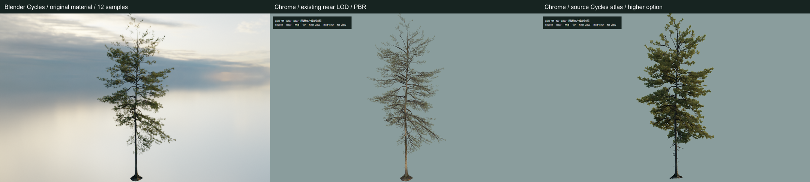
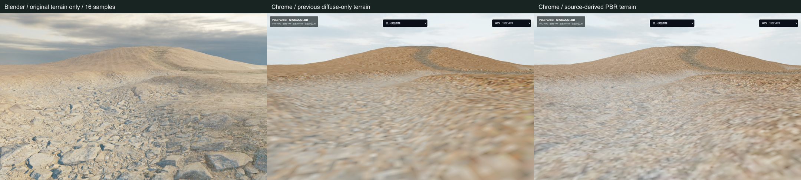
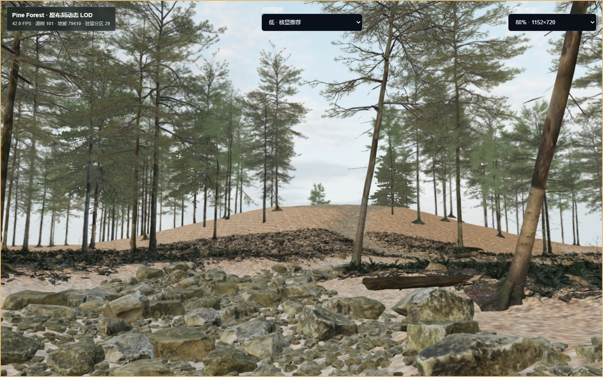
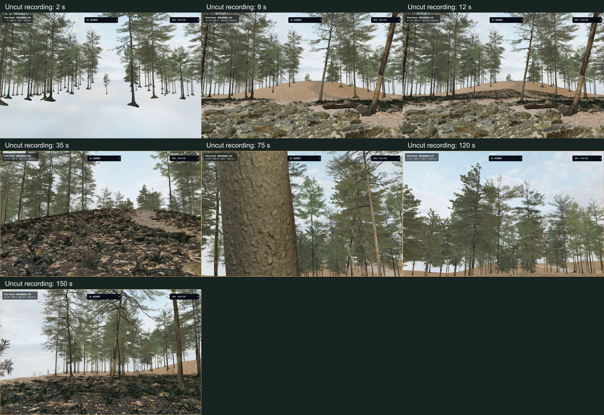

# Pine Forest 第三批 B · 原始美术还原审阅

2026-11-03，分支 `codex/pine-forest-vertical-slice`，起点 `adc258f`。检查点：`f397a0a`（隔离审计）、`a8c204e`（局部美术与运行时修复）。最终证据提交见本文件 Git 历史；本地标签 `pine-batch3b-local-review` 指向交付状态。

**结论：完成局部视觉修复并保留可用低档性能，但整体森林自然度仍未通过。** 地表恢复部分原法线、粗糙度和更高密度颜色；代表树种减少硬角度切换，较高档可选原 Cycles 材质烘焙。近景针叶、地面平坦感、贴片深度和首次补齐仍有明显问题。依照停止条件，不扩大无收益实验，不进入正式森林星球模板阶段。

## 原因与实际修复

### 代表树木：并非只由减面造成

Blender 4.4.3 原生 Python 在工作副本检查原节点、模型和纹理，未保存 `.blend`。原 `pine_twig` 以 Add Shader 将没有接 Alpha 的 Translucent BSDF 加到带 Alpha 的 Principled；glTF 保留 Alpha PBR，未等价保留透射与混合着色。Cycles 自遮挡、环境光和层次也不同。完整源几何在浏览器 PBR 下仍偏稀，不能全部归因于 10% LOD。

`pine_04` 已实际尝试双面双 pass、Alpha 表面覆盖、float UV 和 35% 同源几何。双 pass / float UV 无明显改善；35% 将近景三角形从 669,452 增至 2,326,661，仍未带来自然度的实质收益，未部署。表面覆盖只稍增针叶，不能等价原透射，未进入默认运行时。没有随机增加树叶或重新生成树冠。

左为相同观察位置 Blender 原材质，中央为浏览器近景 PBR，右为新增原 Cycles 图集。右图簇状枝叶来自同一原模型/材质，但固定光照及贴片与近景 PBR 不连续，**只用于较高档试点**。Blender 为 12 samples、降噪、720×450、原 Filmic/world；浏览器为 1440×900/DPR1/80% 内部分辨率，背景及实时光照不同，不能当作像素级等价对照。

[近景 PBR](tree-near.png) · [16方向 PBR](tree-mid.png) · [原 Cycles 图集](tree-cycles-atlas.png) · [未采用试验](tree-trials.png)

### 地表：恢复丢失的原 PBR 信息

原 `main_terrain` 使用 Generated 坐标，`forest_leaves_04 ×150`、`forest_ground_04 ×22`、`rocky_trail ×20`，由原 `path` / `river` 属性混合。旧导出把整块地形压入 2048² DIFFUSE/COLOR，仅 baseColor、常数 roughness 0.95，丢失法线与粗糙度层次。

可复现 Blender 烘焙沿原 UV 派生 4096² baseColor、2048² 切线 normal、1024² roughness，保留原掩膜，不改地形顶点和布局。Three.js 正确处理颜色空间、UV 翻转与贴图通道。三图合计 15,143,902 bytes，默认替换材质；`terrain=legacy` 可回看旧材质。旧 terrain.glb 与缓存材质保留，新图是额外驻留：RGBA8+mipmap 理论增加约 112 MiB，**不是实测 GPU 显存**。

该图特意隐藏植被，只比较同相机地形材质，**不用于森林性能验收**。Blender 为原材质、16 samples、降噪、720×450；Chrome 内部 1152×720。新材质改善颗粒和表面凹凸，但原 shader 有 0.07 / 0.4 / 0.5m displacement，normal 不能恢复真实高度、自遮挡及原光照；近地仍明显模糊、平坦、偏浅。未添加新地貌。

完整森林局部同机位地表旧/新静态对照在 `artifacts-local/pine-batch3b/browser-v2/`：两者均 97 树、79,410 地被、6,921,353 三角形、142 calls，5秒窗口 42.97 → 41.69 FPS，P95 均 33.6ms。这只是局部成本检查。首次 `browser/` 抓到未补齐分区，已排除，没有以缺树画面宣称改善。

### 中远景：只验证和推广一个树种

低档 `pine_04` 复用第三批 16方向 PBR 图集（3,637,424 bytes），较高档使用原完整模型和 Cycles 材质新烘焙的 16方向图集（3,515,020 bytes）。相邻视角按预乘 RGB/Alpha 插值，该树种使用 alpha-to-coverage / depthWrite，减少原先每 22.5° 硬切和部分透明排序问题。其余 10 个树种保留原8方向资源。

仍是多视图 billboard，没有深度视差；插值可能重影，近几何到贴片仍有突变，烘焙光照与周围环境不完全协调，没有新增动态森林阴影。没有扩大为全部资产重做。

### 加载连续性：减少切换空洞，首次补齐未解决

已加载的原585条树位置在地被分区解码时提供同坐标概览；分区驻留后跳过对应概览记录，防止重复。保持原95m、视锥和LOD规则。新批次数量在新LOD填充后统一发布，减少先清旧、后补新造成的多帧缺口。分帧选择、增量矩阵、缓存与释放保留。

但未剪辑视频第2秒仍只有悬空树群，地形/地被尚未就绪。首次有效森林7.30秒，初始资源完成13.04秒；独立无录屏分别5.93 / 8.98秒。本轮基线为4.08 / 8.49秒，启动存在代价。**不能声称视觉连续性已完整通过。** 没有用长时间全屏遮罩掩盖，也未引入整场景 Suspense。

## 实机性能

Windows 11，实际 Chrome（Playwright `channel: chrome` 隔离 headless 实例），Intel Graphics / ANGLE D3D11；CSS1440×900、DPR1、内部1152×720。保留前行、斜行、连续转向、离开释放和返回脚本，由真实键鼠事件驱动 WASD/碰撞。图形任务串行，低档源数量和距离未减少。

| 样本 | 移动平均 FPS | P95 | P99 | >100ms帧 | 起始三角形 / calls |
| --- | ---: | ---: | ---: | ---: | --- |
| 本轮起点 adc258f，低档80% | 43.84 | 33.6ms | 50.1ms | 1 | 6,921,353 / 142 |
| 最终低档80%，独立无录屏 | **45.10** | **33.5ms** | 50.0ms | 0 | 6,921,361 / 142 |
| 最终低档80%，未剪辑录屏 | **42.48** | **33.6ms** | 50.0ms | 1 | 6,921,361 / 142 |
| 较高档80% | 32.45 | 50.1ms | 66.7ms | 3 | 9,067,403 / 163 |

增加8个三角形来自概览按原规则补齐的4棵同源贴片树。最终低档移动88.39秒，所有移动段P95≤33.7ms；密集返回平均36.64 FPS。录屏移动91.36秒，密集静止段P95达50ms，仍有一次>100ms移动尖峰，不能宣称每帧稳定。较高档最慢返回段22.61 FPS、峰值12.48M三角形，不推荐当前核显。

本轮基线与第三批历史48.85 FPS不是同一次采样。碰撞和delta会影响各次实际轨迹，不能以表中差值声称精确提速；每秒相机、方向、提交量和帧间隔保留。结论是本次低档维持可用区间，未观察到明显平均性能崩塌，不保证长期热稳定、所有区域或其他GPU。

| 资源指标 | 本轮基线 | 最终低档无录屏 |
| --- | ---: | ---: |
| 漫游累计资源字节 | 136,887,980 | 153,902,245 |
| 初始 textures / geometries | 78 / 157 | 81 / 157 |
| 采样峰值三角形 / calls | 8,380,666 / 178 | 8,743,220 / 178 |
| 释放 tiles / LOD resources / batches / materials | 35 / 15 / 736 / 7 | 37 / 12 / 761 / 8 |

传输是路线累计浏览器资源统计，不是目录总量；释放是计数器观测，未测独占GPU显存。16-view 2048×4096 RGBA8+mipmap理论约42.7MiB，与压缩文件大小不同。

推荐 `/forest-runtime-lab?scale=0.8`。较高档 `/forest-runtime-lab?scale=0.8&quality=high` 供视觉审阅和未来独显测试，**不是当前核显合格档**。单树 `/forest-lod-lab?species=pine_04&view=near&level=near`。运行时 `impostor=legacy` 关闭插值试点，`impostor=source` 显式检查原Cycles图集。

## 截图与未剪辑视频

[近景](near.png) · [林地与岩石](ground-walk.png) · [中景](mid.png) · [远景](far.png) · [密集返回](return.png) · [较高档](higher.png)

[真实自由行走与转向原始录屏](../../../artifacts-local/pine-batch3b/final-video80/continuous-movement.webm)：**2分36.76秒、1440×900、25fps编码、73,651,285 bytes**，包含加载和静止检查，未剪辑、未加速。25fps是编码率，不是渲染FPS。SHA256 `510b12e11ff955357d7bdbc5abdba09b80aad4cd51c6a4d7239a2c09b0f1f7b7`。

单树实际浏览器相机/atlas完整转圈，单独标记为视角审阅，**不是WASD漫游**：[16方向硬切](../../../artifacts-local/pine-batch3b/final-visuals/turn-detail.webm) · [PBR插值](../../../artifacts-local/pine-batch3b/final-visuals/turn-smooth.webm) · [Cycles插值](../../../artifacts-local/pine-batch3b/final-visuals/turn-source.webm)。

Blender对照仅隔离代表树和地形；本轮**未渲染完整原始森林同机位Cycles中景**，不能据此宣称整片森林已还原。森林中远近截图均来自实际浏览器。

## 完整性与实际检查

- 原.blend及工作副本SHA256前后相同：`fdce77741081f462f11e5cefe8bf79a0bc796727dbb6e51d12fc6cf20e9c9cfb`。脚本断言工作副本名、隔离场景、不保存源文件。最初地面烘焙误同步完整场景已停止，最终改为地形隔离场景完成；失败尝试未当作成功。
- 全部880,410条源名/矩阵复验：585树、879,825地被、60源分区及既有仅树边缘块（61 runtime tiles）；float32最大误差5e-8。38张地被图片和已验证1K路径不变。原几何、材质、纹理、高精度文件没有删除或重排。
- 最终动态槽位审计195次更新、417,648矩阵，最大误差3.795e-6，低→高→低切换通过。漫游无记录到的页面/Shader/上下文错误；Storage/IndexedDB调用为零。主动context loss提示、撤销旧ready及重载恢复通过。
- 实际完整通过 `npm.cmd run lint`、`npm.cmd run typecheck`、`npm.cmd test` **46/46**、`npm.cmd run build`、`npm.cmd run test:e2e` **33/33**。常规回归使用隔离测试档案，不操作日常浏览器资料；最终常规检查在图形测试后进行，没有与主性能样本重叠。
- 正式Galaxy/Planet/Memory、schema、Provider和数据仓库未修改，未清空localStorage/IndexedDB，未合并main。相机修复、Shader诊断、恢复、WASD和碰撞保留。没有安装新MCP、升级引擎或搜索替代森林。

可复现脚本在 `scripts/forest-lab/`：`audit-batch3b-materials.py`、`bake-source-terrain-pbr.py`、`render-batch3b-source-impostor.py`、`render-batch3b-terrain-reference.py` 对已验证副本执行；`package-terrain-pbr.mjs` / `package-source-impostor.mjs` 打包；`run-batch3b-acceptance.mjs` 串行Chrome检查，`publish-batch3b-evidence.mjs` 发布截图/统计及校验副本。需要本机源工程与前批资源，大型资产不进普通Git。

派生资源已复制到 `%LOCALAPPDATA%/UNIVERSE-OF-ME/asset-audit/candidate-assets/pine-source-conversion/batch3b-delivery/` 并逐文件SHA校验，8文件约22.3MB，原前批档案保留。未采用的35%几何仅是本地忽略实验，不是默认资产。

原始数据在 `artifacts-local/pine-batch3b/{baseline,accepted-low80,final-video80,final-high80}/results.json`。串行作业记录包含video/higher/instances/recovery/visuals/integrity全部exit0；clean在队列结束后单独成功运行，旧作业JSON没有clean条目，最终脚本已将clean放回开头供复现。早期`final-low80`后半段与lint重叠，不作为主结果；早期未稳定`browser/`不用作视觉对照。

[性能与资源清单](summary.json) · [源布局验证](asset-validation.json) · [动态矩阵](instance-audit.json) · [上下文恢复](context-recovery.json) · [串行作业记录](acceptance-jobs.json) · [常规检查结果](checks.json)

## 未解决与停止结论

1. 近景针叶明显稀疏，原透射/混合与自遮挡未等价恢复；加几何无实质收益，不扩大。
2. 代表图集改善覆盖，但固定光照、近中景差异、重影和平面感仍在；其余树种仍有8方向切换。
3. 地面缺少原displacement、接触遮挡和匹配森林光影；近地模糊、浅坡平淡，原河流材质未专项修复。
4. 首次地形/地被延迟补齐明显，构图变化未彻底解决；原始录屏开头如实保留。
5. 低档可用；较高档、长时热稳定、完整森林Blender对照及其他硬件尚未通过验收。

本轮到此停止。**不将局部改善视为基础环境最终美术通过，不自动封装正式森林星球模板。**
