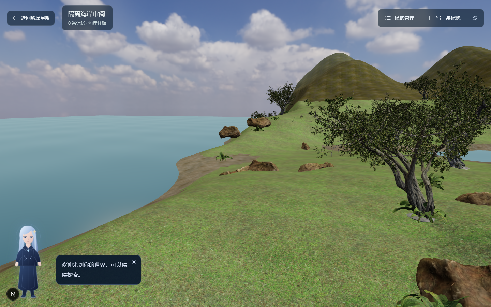
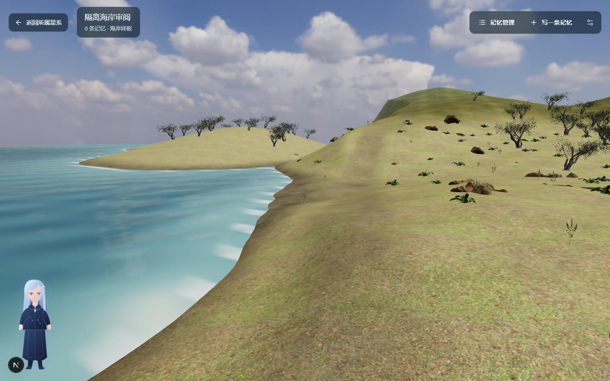
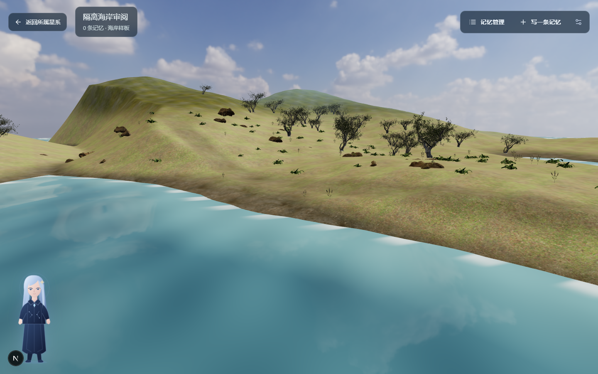
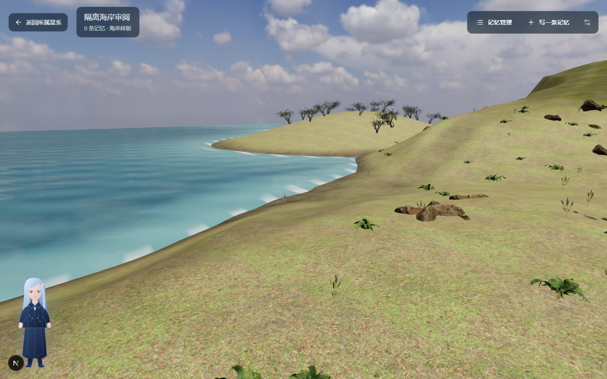
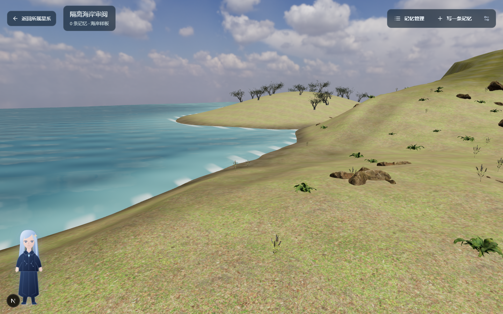
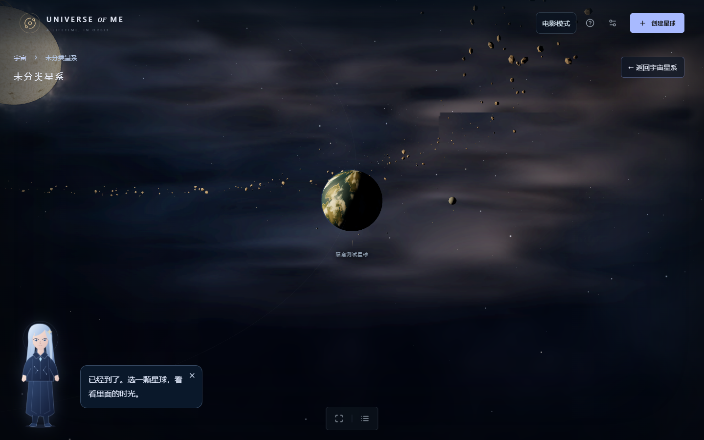
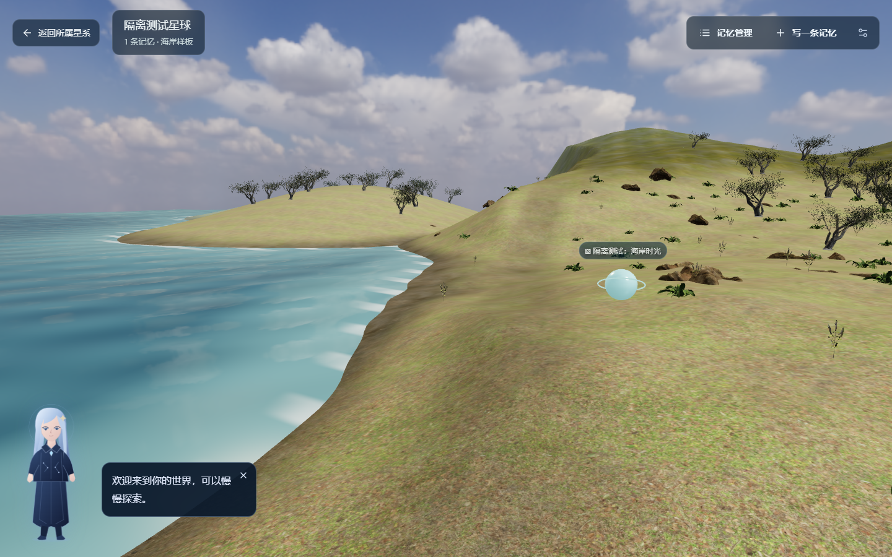

# V4.2-R1 实际浏览器视觉审阅

这些图片来自本机 Chrome 156 对真实 Three.js 场景的截图，不是概念图或生成背景。个人星球与记忆仅存在于测试的隔离浏览器上下文。

## 同一机位对比

两图均为 1440×900、DPR 1、相机位置 `[8,6,19]`、观察目标 `[0,1.5,-8]`、FOV 56°。

| V4.2 基线 | V4.2-R1 |
| --- | --- |
|  |  |

## 其他实际视角

| 森林方向 | 海面与岸线 | 近景 |
| --- | --- | --- |
|  |  |  |

| 星系中的真实海洋星球 | 真实记忆球在世界中 |
| --- | --- |
|  |  |

全程录像保存在本机 `test-results/visual-slice-ocean-visual--bcde2--and-returns-to-exploration/video.webm`；自由探索录像保存在 `artifacts-local/v4-2-r1/after/coast-exploration.webm`。录像未加入普通 Git 历史。原始性能数据见 [优化前](before-metrics.json)、[优化后](after-metrics.json)、[设备与资源](device.json)和[浏览器诊断](diagnostics.json)。

仍未达到最终写实美术标准：地貌轮廓缺少人工雕刻，树种少，自动 LOD 的枝叶较稀，外球与局部地表没有地理贴图级衔接。此页用于实际视觉验收，不以自动化测试代替观感判断。
