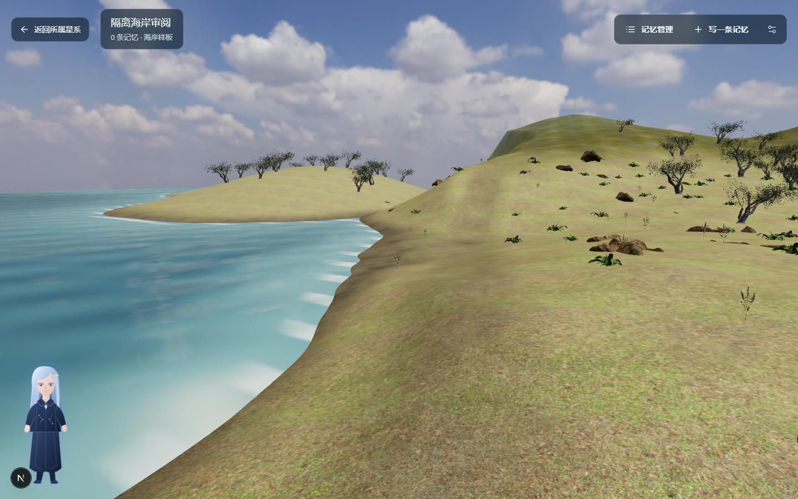
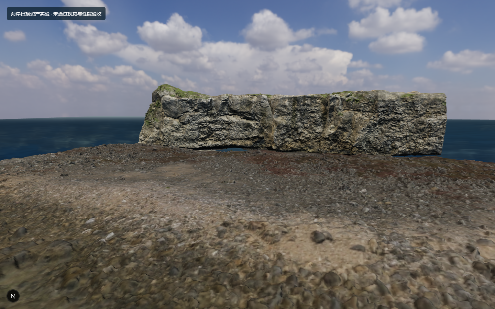
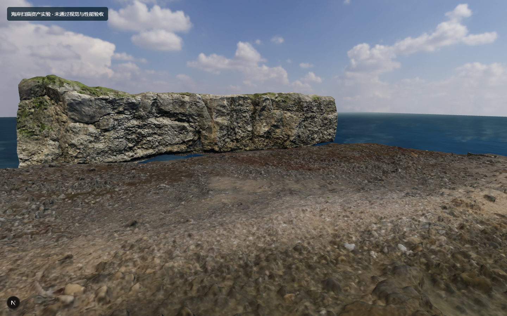
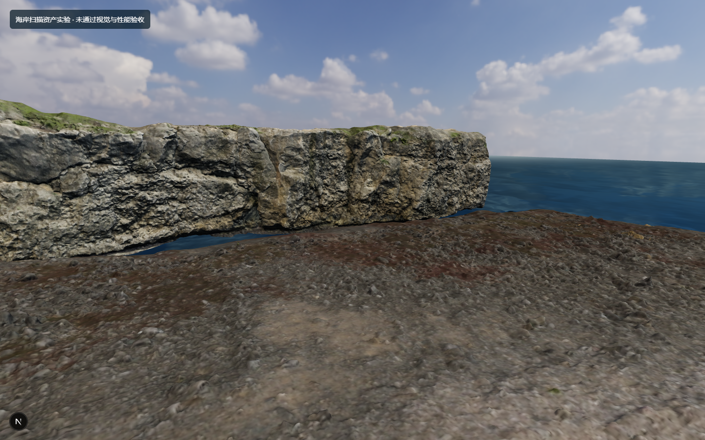

# V4.2-R2 成熟 3D 技术与海岸扫描资产验证

**结论：本轮海岸实验未通过视觉或性能验收，正式星球仍使用 R1 场景。** `/coast-lab` 是独立、可运行的失败验证，方便审查技术边界；它不读取或改写个人档案，也没有接入星球导航。继续随机摆放扫描件不会达到目标。

## 浏览器实景对照

下图都由本机 Chrome 156 的 Three.js/WebGL 实际帧截取，视口 1440×900、DPR 1、相机 `[8,6,19]`、目标 `[0,1.5,-8]`、FOV 56°。R1 截图来自原样板，R2 来自独立 `/coast-lab`，没有使用概念图作为背景。

| R1 现有场景 | R2 扫描资产实验 |
| --- | --- |
|  |  |

| R2 横向观察 | R2 前进行走 |
| --- | --- |
|  |  |

本机浏览器探索录屏：`artifacts-local/v4-2-r2/browser/coast-lab-exploration.webm`。原始[性能与资源请求](browser-measurements.json)、[上游 Demo 观察结果](upstream-observations.json)也保留。运行实验：`npm.cmd run dev -- -p 3301` 后打开 `http://127.0.0.1:3301/coast-lab`；当前若 3301 服务已运行，可直接打开。

### 实际差距

- **局部模型：** Poly Haven 的真实扫描岸线和崖壁拥有明显更细致的侵蚀、碎石与 PBR 纹理，这是相对 R1 的真实收益。
- **整体地貌：** 崖壁像一块独立竖板；横向端面和与地面的接缝裸露，岸线没有地质连续性。R1 的坡面单调，但 R2 并未形成更可信的完整海湾。
- **植被与空间：** 扫描资产的海岸上方没有可用林地与完整树木群落；前景、森林中景、远处山脉仍缺失，达不到用户提供的生命世界概念方向。
- **海水：** Three.js Water2 有实时反射、折射与法线流动，但没有与岸线几何相匹配的湿沙、浅滩、破浪、潮间带；远看仍是海面平板。
- **天空：** 现有 Poly Haven HDR 能提供可信云层与环境光，可保留。天空并非主要瓶颈。
- **性能：** 同机 R1 约 56 FPS、17.89 ms、149.9 万三角形；R2 五个稳定窗口为 27–29 FPS、34–37 ms、216.3 万三角形，Water2 另有两次离屏渲染。R2 请求 HDR、GLB 和法线图约 55.6 MB，JS heap 约 206–211 MB。设备为 Windows 11、Intel Graphics D3D11、Headless Chrome 156；真实显存未测得。这不是移动端验收。

## 真实资产与授权

| 资产/技术 | 来源与许可证 | R2 使用与限制 |
| --- | --- | --- |
| Coast Line 01 | [Poly Haven](https://polyhaven.com/a/coast_line_01)，[CC0](https://polyhaven.com/license) | 1K glTF 原始扫描，经 Blender 4.2.23 导出 GLB；约 53.9 万面 |
| Coastal Cliff 02 | [Poly Haven](https://polyhaven.com/a/coastal_cliff_02)，CC0 | 1K glTF，约 94.3 万面；截面/接地须人工编辑 |
| Coast Rocks 01 | [Poly Haven](https://polyhaven.com/a/coast_rocks_01)，CC0 | 1K glTF，约 68.0 万面 |
| Kloofendal partly cloudy sky | [Poly Haven](https://polyhaven.com/a/kloofendal_48d_partly_cloudy_puresky)，CC0 | 复用 R1 2K HDR；不是海岸几何或场景背景图 |
| Water2 与两张法线图 | [Three.js r180](https://github.com/mrdoob/three.js/tree/r180/examples/jsm/objects)，[MIT](https://github.com/mrdoob/three.js/blob/r180/LICENSE) | 反射/折射额外通道成本高，不适合此设备作为默认水面 |

三个 Poly Haven 下载由 `scripts/world-slice/download-r2-assets.mjs` 按官方 API 的 MD5/长度校验，源文件留在 `%LOCALAPPDATA%`。GLB 是经 Blender 整理的源扫描，按现有 Git LFS 规则管理；不是原创定制地貌。示例 Demo 中的独立纹理和美术图片**不因项目代码开源而自动获得授权**，本轮没有复制它们。

## GitHub 候选和实际 Demo

| 候选 | 实际演示与观察 | 许可证、维护和当前兼容性 | 决定 |
| --- | --- | --- | --- |
| [nwpointer/three-landscape](https://github.com/nwpointer/three-landscape) | [Highlands](https://three-landscape.vercel.app/) 在本机 Chrome 等待 13 秒仍是加载黑屏，无法据此确认视觉质量 | MIT；仓库最后推送 2023-07；包 peer 为 R3F 8 / React 18，现有 R3F 9 / React 19 不兼容保证。作者明确要求离线制作高度图与纹理 | 不集成。其 splat/LOD 思路不能替代美术地形 |
| [kenjinp/hello-terrain](https://github.com/kenjinp/hello-terrain) | [角色地形示例](https://hello-terrain.kenny.wtf/examples/raycast-character-controller) 在本机显示 booting/纯色，未验证成熟海岸画质 | MIT；近期维护；0.0.0-alpha.15，React 包 peer 含 R3F 9，但文档默认 WebGPU/R3F 10；独立地形引擎无海岸资产 | 保留作大范围地形和碰撞候选，不在本轮集成 alpha |
| [takram-design-engineering/three-geospatial](https://github.com/takram-design-engineering/three-geospatial) | [Atmosphere Basic](https://takram-design-engineering.github.io/three-geospatial/?path=/story/atmosphere-atmosphere--basic) 实际渲染自然天空散射，但示例是几何测试场景 | MIT；维护中；`@takram/three-atmosphere` peer 支持 Three 0.180/R3F 9/Drei 10，状态 Beta；WebGPU API 重写进行中 | 后续可单独试大气，不能解决地貌与植被主缺口 |
| [pmndrs/sky](https://github.com/pmndrs/sky) | [Sagami Bay](https://sky.docs.pmnd.rs/examples/fuji/) 运行画面有成熟调色与空间氛围；该画面的场景资产不能自动复用 | MIT；近期维护；当前 0.6.0 需要 WebGPU、Three ≥0.186、R3F ≥10 alpha，和本站 0.180/9 不兼容 | 不为天空升级整套依赖 |
| [Drei / Three Water2 + Poly Haven](https://github.com/pmndrs/drei) | 本页 `/coast-lab` 为真实集成证据 | Drei MIT，本站已有 10.7.7；Three 0.180 的 Water2 MIT；Poly Haven 扫描 CC0。兼容但三块大扫描和双水面通道成本过高 | 保留 HDR/部分真实资产技术经验，实验画面不进入正式星球 |

[pmndrs/postprocessing](https://github.com/pmndrs/postprocessing) 为 Zlib；当前 6.39.1 的 Three peer 范围包含 0.180，R3F 包 3.0.4 支持 R3F 9。但后期效果不能补出缺失的地形、植被和接缝，本轮没有集成。[playcanvas/engine](https://github.com/playcanvas/engine) 为 MIT、持续维护；两引擎都仍需要同一套美术场景。本轮没有证据证明引擎切换能改善这些扫描件的接缝或资源体积，因此没有启动第二套引擎实验，也不会迁移正式网站。

## 停止条件与下一步资产工作

现有 Three.js/R3F **能渲染高细节扫描模型**，但这次集成**没有证明能在目标集成显卡预算内呈现高品质、可自由探索的完整海岸**。最缺的是一块经过人工环境美术制作的连续可行走地貌：在 Blender 中雕刻海湾/崖壁/沙滩，扫描件重拓扑与 LOD、遮蔽边缘并绘制地表权重；再布置不同树种、灌木、漂木与岸岩，制作潮间带和匹配的水边遮罩。专业环境美术或合法完整场景包会比继续随机摆放单体扫描件有效。

下一次验证应先取得可编辑的完整环境资产和授权，再以相同固定机位与约 60 FPS 中档目标检查浏览器截图。只有通过视觉审核后，才考虑自由探索扩展、动态环境、内外星球衔接或 PlayCanvas 对照。R2 实验不修改 `Galaxy`、`Planet`、`Memory`、localStorage 或 IndexedDB，不触碰现有正式场景。
