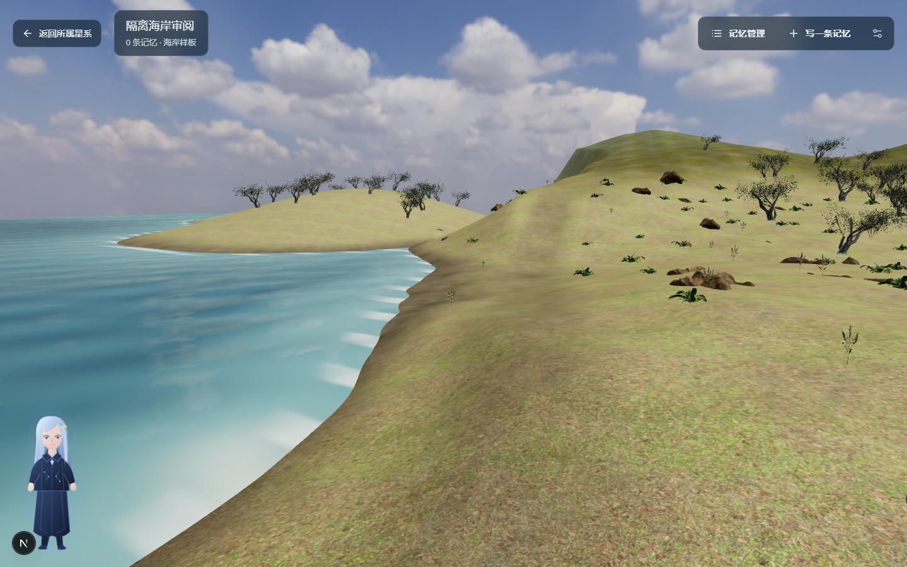
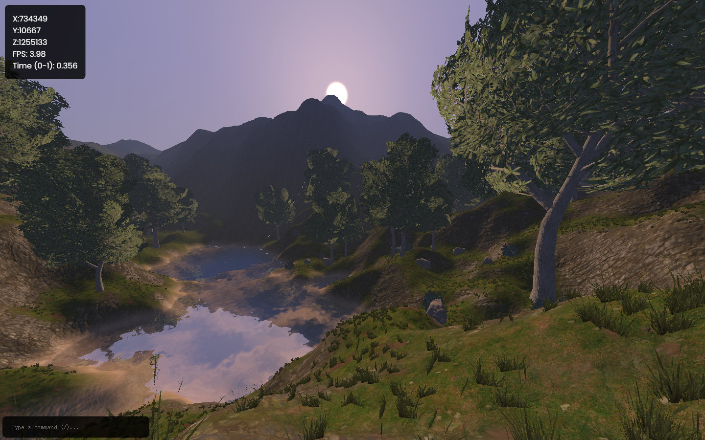
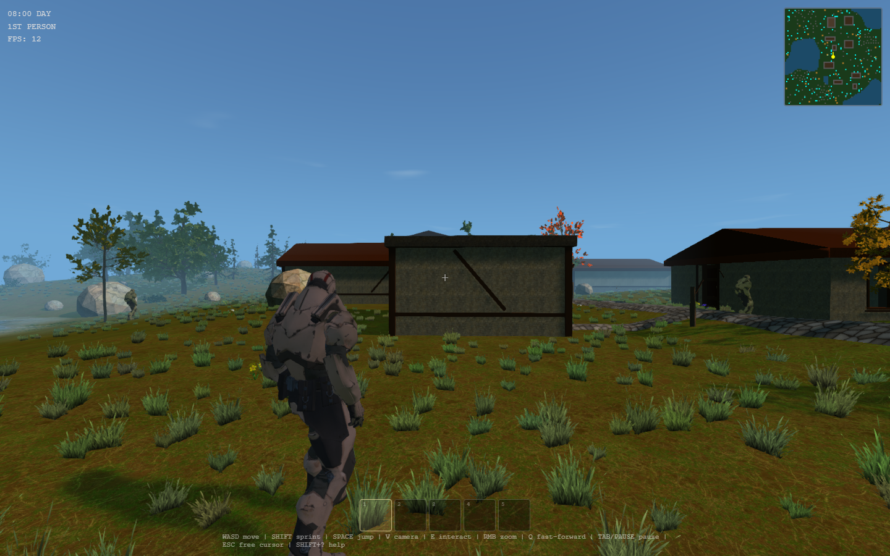
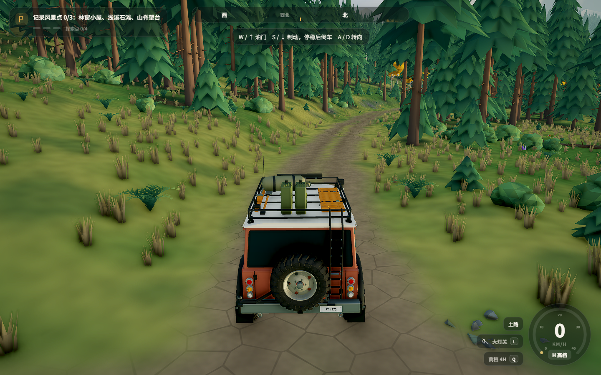
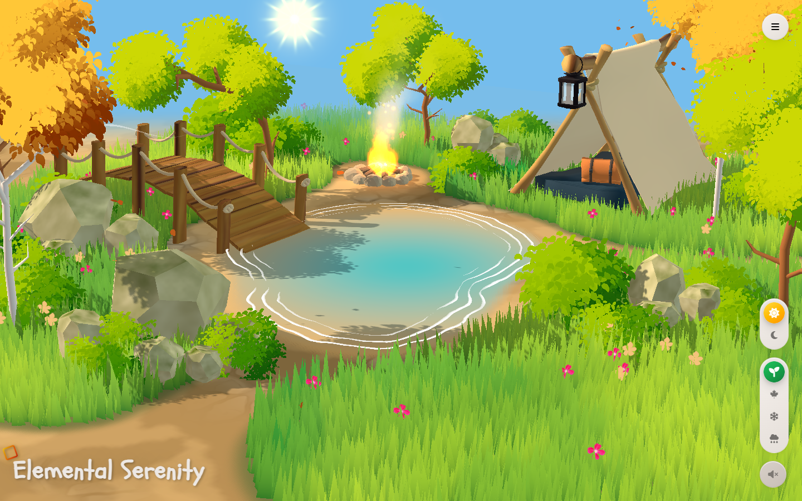
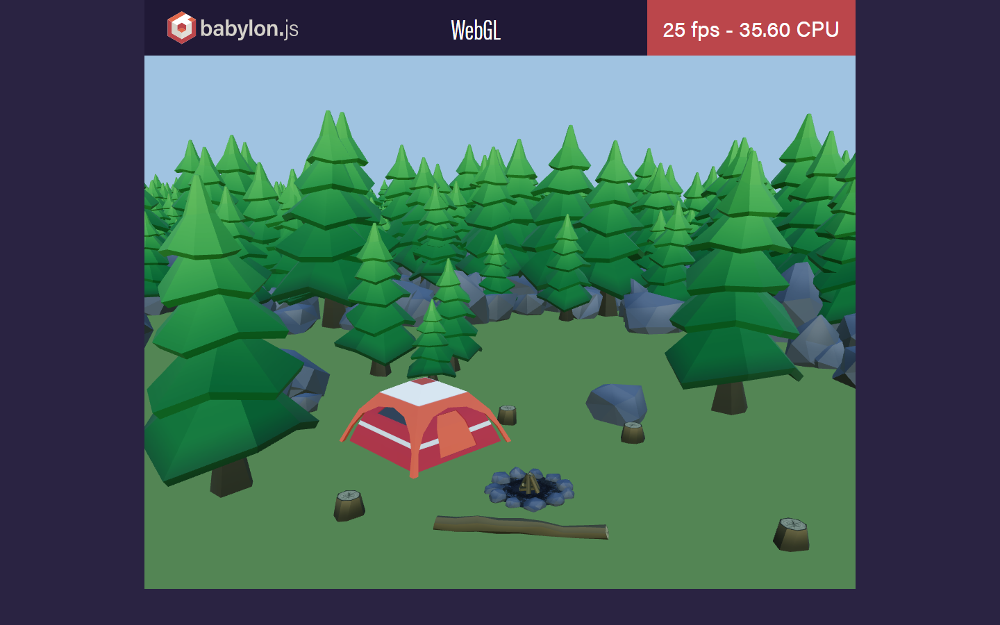

# V4.2-R3 complete environment audit

Date: 2026-11-01. This is a research gate, not a new planet scene. All screenshots below are actual frames from the candidates' original browser demos. No candidate code, model, texture, or audio was copied into UNIVERSE OF ME. The R1 comparison is an actual frame from the existing project, but the external demos do not share its camera or art direction, so this is a qualitative comparison, not a controlled A/B render.

## Decision

**No candidate currently passes all four gates: a clearly better complete environment, free exploration, acceptable performance on the test device, and a legal path to reuse the complete scene. Do not integrate one yet.** Inriz is the strongest visual reference among those actually run, but its scene source and asset rights are not available from the demo page or a discoverable GitHub repository. Its current frame rate is also below the target. Replacing the R1 scene with any of the other candidates would not solve the visual problem.

The useful change in direction is a **complete environment art workflow**: one editable terrain with authored shore and access paths; matching vegetation, rock and water assets; placement and occlusion authored together; Blender scene source and exported LODs. An engine switch alone does not provide this. The next meaningful proof requires a licensed, editable whole-scene package or a professional environment artist who can create one. Continue to use the existing Three.js runtime until a same-asset engine comparison demonstrates a reason to change it.

## Original demo evidence

| Candidate | Original demo and source | What the actual run showed | Reuse boundary |
| --- | --- | --- | --- |
| **Inriz WebGL2 Terrain** | [Live terrain](https://www.inriz.com/terrain/); no corresponding public repository found in GitHub repository search on 2026-11-01 | The best continuous valley/water/forest composition here; WASD moved the world coordinates. 1440x900 about **21 FPS**, 1080x675 about **29 FPS** with large frame spikes during terrain generation. Not a coast scene. | No source/asset license located on the demo page. Study the composition; do not copy its scripts, meshes, textures or screenshots into the product. |
| **Dark Strands** | [Live demo](https://darkst.netlify.app/), [GitHub](https://github.com/VictorZakharov/dark-strands) | Full walkable Babylon.js 9 village, hills, forest, water, sky and weather. The world loaded and displayed, but in-game HUD read about **12-13 FPS** at 1440x900. Textured and coherent, still visibly procedural and not near the desired coastal art quality. | Repository [MIT](https://github.com/VictorZakharov/dark-strands/blob/main/LICENSE). It contains external `ez-tree` and other assets; verify each asset's license before reuse. Engine source license is not blanket art clearance. |
| **Forest Trail** | [Live demo](https://warren-swr.github.io/forest-trail/), [GitHub](https://github.com/Warren-swr/forest-trail) | Complete drivable PlayCanvas forest, road, stream and mountain composition; visual style is deliberately low-poly. Game scene about **4.4 FPS** at 1440x900 on this device. Demonstrates authored route and landscape pacing, not target fidelity. | No project-wide license found. [Credits](https://github.com/Warren-swr/forest-trail/blob/main/game/docs/CREDITS.md) call the scene assets original and music CC BY 4.0; the separately listed Kenney CC0 packs do not license the entire project. Research only until permission is obtained. |
| **Elemental Serenity** | [Live demo](https://elemental-serenity.vercel.app/), [GitHub](https://github.com/SahilK-027/Elemental-Serenity) | Carefully composed pond/bridge/camp diorama with season and weather controls. About **26 FPS** at 1440x900 after entering. It is a small fixed scene, not a freely walkable world, and its bright stylized art differs from the desired coast. | Repository [MIT](https://github.com/SahilK-027/Elemental-Serenity/blob/main/LICENSE); separately confirm the GLB, sky cube and texture origins before asset reuse. |
| **Babylon Forest WebGL** | [Official WebGL demo](https://www.babylonjs.com/Demos/WebGPU/forestWebGL.html), [Babylon.js engine](https://github.com/BabylonJS/Babylon.js) | Repeated low-poly trees and camp objects, with a 1024x768 canvas. About **29 FPS** in WebGL. The WebGPU counterpart did not finish its 10,000-element cloning stage during a 20-second observation. Neither image meets the art target. | Babylon engine is Apache-2.0; demo glTF/environment asset rights require separate confirmation. The HTML source is publicly inspectable, not proof that its art is reusable. |

### Browser frames

| Existing R1 coast | Inriz original terrain |
| --- | --- |
|  |  |

| Dark Strands | Forest Trail |
| --- | --- |
|  |  |

| Elemental Serenity | Babylon Forest WebGL |
| --- | --- |
|  |  |

The Inriz screenshot has a landing HUD overlay in the first captured frame; the world screenshot above was taken **after** entering its 1440x900 mode. The optional local exploration recording is `artifacts-local/v4-2-r3-video/page@ce359cd59a37ea8117c11051760277b5.webm`; its HUD coordinates change from `X:734349, Y:10667, Z:1255133` to `X:728719, Y:6351, Z:1260026` after a 3.5-second W input. The video is not committed to ordinary Git history. Other original-demo screenshots, including menus and loading failures, are kept in `artifacts-local/v4-2-r3-*.png`.

## Measurement limits

All candidates were opened in isolated **headed** Chrome 156 on Windows 11 with Intel Graphics, 1440x900 browser viewport and DPR 1. Each app selected its own canvas/quality settings. Values are short `requestAnimationFrame` interval samples after the visible scene settled, except Dark Strands' own HUD value; these are browser presentation estimates, not GPU timestamps. The R1 baseline was captured separately in headless Chrome, so its approximately 56 FPS from [R1 measurements](../v4-2-r1/after-metrics.json) is context, not a statistically controlled head-to-head benchmark. Browser resource `transferSize` is not VRAM. No real mobile device was measured.

| Candidate and mode | Canvas | Observed FPS | Median / P95 frame interval | Browser transfer size / JS heap | Limitation |
| --- | --- | ---: | ---: | ---: | --- |
| Inriz highest | 1440x900 | 21 | 33 / 134 ms | ~39 MB / 111 MB | Noticeable terrain-generation stalls while walking |
| Inriz medium | 1080x675 | 29 | 17 / 83 ms | ~39 MB / 106 MB | Still below a stable 30 FPS in sampled window |
| Dark Strands world | 1440x900 | 12-13 HUD | Not captured | ~12 MB transfer | Strongly under budget; no GPU memory reading |
| Forest Trail world | 1440x900 | 4.4 | 233 / 267 ms | Not captured | Too slow on current Intel GPU |
| Elemental Serenity world | 1440x900 | 26 | 33 / 67 ms | ~6.8 MB / 20 MB | Fixed diorama, no ground traversal |
| Babylon Forest WebGL | 1024x768 | 29 | 33 / 50 ms | ~1.3 MB / 251 MB | Smaller canvas and below-target art |

The candidates' original scenes had no observed console errors during the measured world runs, except a non-blocking 404 on Inriz's page. The purpose of these runs is screening, not certification or an equal-quality engine benchmark.

## Art and workflow findings

- Inriz's spatial continuity comes from one valley landform, a watercourse that follows the terrain, varied vegetation silhouettes and a mountain backdrop. Its rendering stack alone is not a portable scene. Source and asset permission are the blocking gaps.
- Dark Strands shows how an integrated world coordinates roads, buildings, trees, weather and first/third-person camera collision. Its 12-13 FPS on this test device and procedural art prevent direct adoption as the production planet.
- Forest Trail demonstrates authored exploration rhythm along a route rather than random decoration, but its low-poly art and severe frame time make it a design reference only.
- Elemental Serenity demonstrates careful small-area composition. Its fixed diorama proves that a polished frame can be inexpensive in asset bytes while still missing the required ground exploration.
- Babylon Forest is a useful engine/instancing stress demo, not a high-quality environment asset. WebGPU availability alone does not improve its art or guarantee a faster load.

### Editable asset leads, not browser-verified candidates

Search also found [BlendKit Green Forest Landscape](https://www.blendkit.com/asset-gallery-detail/20040ee1-c06c-43da-86ed-f7cba94e196c/) and a downloadable [Sketchfab Beach Scene Environment](https://sketchfab.com/3d-models/beach-scene-environment-f57c063fdac54d048fce956b1c5a9297). The latter page identifies **CC BY 4.0** and roughly **17,000 triangles**; the former requires checking the specific asset's BlendKit license and actual Blender source. Neither was downloaded, opened in Blender, or run in WebGL this turn. Their listing renders and viewer thumbnails are therefore **not evidence of a production-ready walkable environment**. They remain possible sources for a future whole-scene asset audit, not integration choices.

### Smallest prerequisite for another integration attempt

Acquire **one editable, licensed whole-scene environment** with Blender source or equivalent: continuous sculpted coast or valley, terrain material masks, authored water edge, rocks/vegetation with LODs and collision proxies, sky/lighting setup, and an asset manifest stating each license. Validate its unmodified browser export on this Intel GPU at 1440x900 and at a 1080x675 quality tier. Only then make an isolated adapter to the current R3F planet world; compare the same assets and camera in PlayCanvas/Babylon only if a specific rendering or editing benefit remains. No source or data migration is authorized by this audit.
